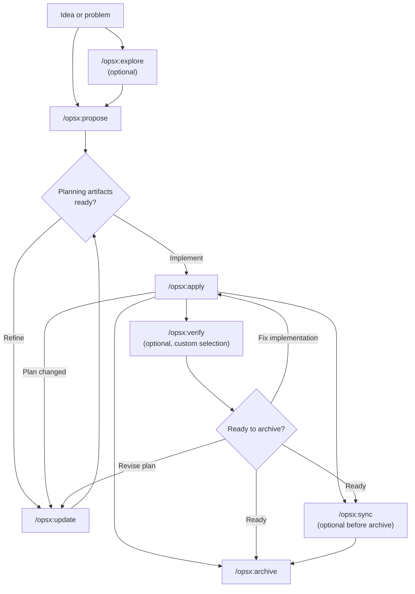
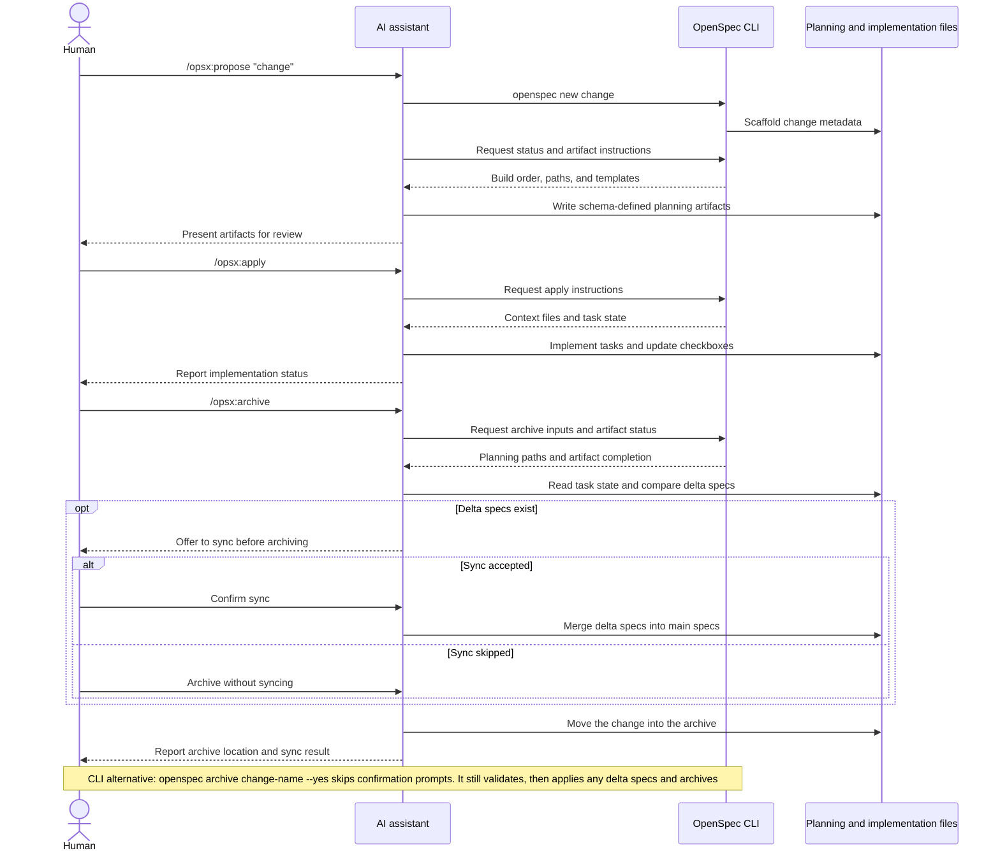

## 8 workflows —— 工作流

> 译自 `reference/openspec/docs/workflows.md`（原文 552 行，全文翻译）。按 `READING-openspec.md` 第 08 项。代码块与 ASCII 图按原样保留。

本指南介绍 OpenSpec 的常见工作流模式，以及各自何时使用。基础配置见 [入门（Getting Started）](getting-started.md)。命令参考见 [命令（Commands）](commands.md)。

### 8.1 哲学：是动作，不是阶段（Philosophy: Actions, Not Phases）

传统工作流逼你走完一个个阶段：先规划，再实现，然后完成。但真实的工作并不整齐地装进格子里。

OPSX 换了一种做法：

```text
Traditional (phase-locked):

  PLANNING ────────► IMPLEMENTING ────────► DONE
      │                    │
      │   "Can't go back"  │
      └────────────────────┘

OPSX (fluid actions):

  proposal ──► specs ──► design ──► tasks ──► implement
```

**核心原则：**

- **是动作，不是阶段** —— 命令是你能做的事，不是把你卡住的阶段
- **依赖是使能者** —— 它们展示什么是可能的，而不是接下来什么是必需的

> **自定义：** OPSX 工作流由定义 artifact 序列的 schema 驱动。创建自定义 schema 的细节见 [自定义（Customization）](customization.md)。

### 8.2 工作流一览（Workflow at a Glance）

默认工作流保持流动：探索与验证是可选的，而且只要实现暴露出新东西，你随时可以更新规划 artifact。



AI 助手驱动工作流，而 CLI 提供确定性的脚手架、状态与 artifact 指令：



### 8.3 两种模式（Two Modes）

#### 默认快捷路径（Default Quick Path (`core` profile)）

新安装默认使用 `core`，它提供：
- `/opsx:explore`
- `/opsx:propose`
- `/opsx:apply`
- `/opsx:update`
- `/opsx:sync`
- `/opsx:archive`

典型流程：

```text
/opsx:explore ──► /opsx:propose ──► /opsx:apply ──► /opsx:sync ──► /opsx:archive
  (optional)
```

##### 从探索开始（值得养成的习惯）（Start by exploring (the habit worth forming)）

`/opsx:explore` 是默认档的一部分，不是进阶附加项。每当你有一个问题但还没有方案时，就该走这一步 —— 而在有 AI 助手的情况下，大多数时候都是这样。

```text
You: /opsx:explore

AI:  What would you like to explore?

You: Our search results feel stale. I'm not sure if it's caching,
     indexing, or the query itself.

AI:  Let me look... [reads the search service and cache layer]
     It's the index: it only rebuilds nightly, so edits don't show
     up until the next day. Two options: rebuild on write (simple,
     more load) or a short-TTL cache invalidation (more moving parts,
     less load). Given your write volume is low, rebuild-on-write is
     the cleaner fix. Want to scope it?

You: Yes.

You: /opsx:propose rebuild-search-index-on-write
```

探索从不写代码，也不会写别的任何东西，除非你要求，或者它提出时你答应。它是一场零成本、无风险的对话，把模糊的担忧变成一个精确的 change，于是接下来的 proposal 会很锐利。已经确切知道自己想要什么？跳过它，直接去 `/opsx:propose`。完整指南：[先探索（Explore First）](explore.md)。

#### 扩展/完整工作流（自定义选择）（Expanded/Full Workflow (custom selection)）

如果你想要显式的「搭脚手架再构建」命令（`/opsx:new`、`/opsx:continue`、`/opsx:ff`、`/opsx:verify`、`/opsx:bulk-archive`、`/opsx:onboard`），用下面两条启用它们：

```bash
openspec config profile
openspec update
```

### 8.4 工作流模式（扩展模式）（Workflow Patterns (Expanded Mode)）

#### 快速功能（Quick Feature）

当你知道想构建什么、只需要执行时：

```text
/opsx:new ──► /opsx:ff ──► /opsx:apply ──► /opsx:verify ──► /opsx:archive
```

**示例对话：**

```text
You: /opsx:new add-logout-button

AI:  Created openspec/changes/add-logout-button/
     Ready to create: proposal

You: /opsx:ff

AI:  Creating all planning artifacts...
     ✓ proposal.md
     ✓ specs/
     ✓ design.md
     ✓ tasks.md
     Ready for implementation!

You: /opsx:apply

AI:  Working through tasks...
     ✓ Added logout button to header
     ✓ Implemented session clearing
     ✓ Added confirmation dialog
     All tasks complete!

You: /opsx:archive

AI:  ✓ Merged specs
     ✓ Archived change
```

**最适合：** 小到中型功能、修 bug、直截了当的改动。

#### 探索式（Exploratory）

当需求不清楚、或你需要先做调查时：

```text
/opsx:explore ──► /opsx:new ──► /opsx:continue ──► ... ──► /opsx:apply
```

**示例对话：**

```text
You: /opsx:explore

AI:  What would you like to explore?

You: I want to improve page load performance but I'm not sure
     where the bottlenecks are.

AI:  Let me help investigate...
     [Analyzes bundle sizes, identifies slow queries, reviews
     component render patterns]

     I found three main bottlenecks:
     1. Large unoptimized images
     2. Synchronous data fetching in ProductList
     3. Re-renders from context changes

     Which would you like to address first?

You: Let's tackle the data fetching issue.

You: /opsx:new optimize-product-list-fetching

AI:  Created change. Ready to create: proposal

You: /opsx:continue

AI:  Creating proposal based on our exploration...
     [Writes proposal incorporating investigation insights]

     Ready to create: specs, design
     Which would you like next?

You: /opsx:continue

AI:  Creating specs...
```

**最适合：** 性能优化、调试、架构决策、不清楚的需求。

#### 并行变更（Parallel Changes）

同时处理多个 change：

```text
Change A: /opsx:new ──► /opsx:ff ──► /opsx:apply (in progress)
                                         │
                                    context switch
                                         │
Change B: /opsx:new ──► /opsx:ff ──────► /opsx:apply
```

**示例对话：**

```text
You: I'm working on add-dark-mode but got pulled into a bug fix

You: /opsx:new fix-login-redirect

AI:  Created openspec/changes/fix-login-redirect/

You: /opsx:ff

AI:  ✓ Created planning artifacts

You: /opsx:apply

AI:  Working on fix-login-redirect...
     [Implements the fix]
     All tasks complete!

You: /opsx:archive

AI:  ✓ Archived fix-login-redirect

You: Let's get back to dark mode

You: /opsx:apply add-dark-mode

AI:  Resuming add-dark-mode...
     Picking up at task 2.3: Update Header...
```

**最适合：** 并行工作流、紧急打断、团队协作。

当你有多个已完成的 change 时，用 `/opsx:bulk-archive`：

```text
You: /opsx:bulk-archive

AI:  Found 3 completed changes:
     - add-dark-mode (all tasks done)
     - fix-login-redirect (all tasks done)
     - update-footer (all tasks done)

     Checking for spec conflicts...
     ⚠ add-dark-mode and update-footer both touch specs/ui/

     Inspecting codebase to resolve...
     Both changes are implemented. Will apply in chronological order.

     Archive all 3 changes?

You: Yes

AI:  ✓ Archived add-dark-mode
     ✓ Archived fix-login-redirect
     ✓ Archived update-footer
     Specs merged in order: add-dark-mode → update-footer
```

批量归档会检测多个 change 是否碰到同一批 spec，并通过核对什么被真正实现了来解决冲突。

#### 完成一个 Change（Completing a Change）

推荐的收尾流程：

```text
/opsx:apply ──► /opsx:verify ──► /opsx:archive
                    │                 │
              validates          prompts to sync
              implementation     if needed
```

##### Verify：检查你的工作（Verify: Check Your Work）

`/opsx:verify` 从三个维度校验实现是否与你的 artifact 相符：

```text
You: /opsx:verify

AI:  Verifying add-auth...

     COMPLETENESS
     ✓ All 12 tasks in tasks.md are checked
     ✓ All requirements in specs have corresponding code
     ⚠ Scenario "Session timeout after inactivity" not tested

     CORRECTNESS
     ✓ Implementation matches spec intent
     ✓ Edge cases from scenarios are handled
     ✓ Error states match spec definitions

     COHERENCE
     ✓ Design decisions reflected in code structure
     ✓ Naming conventions consistent with design.md
     ⚠ Design mentions "event-driven" but implementation uses polling

     SUMMARY
     ─────────────────────────────
     Critical issues: 0
     Warnings: 2
     Ready to archive: Yes (with warnings)

     Recommendations:
     1. Add test for session timeout scenario
     2. Consider refactoring to event-driven as designed, or update design.md
```

**verify 检查什么：**

| 维度 | 它校验什么 |
|-----------|------------------|
| Completeness | 所有 task 完成、所有 requirement 已实现、scenario 已覆盖 |
| Correctness | 实现符合 spec 意图、边界情况已处理 |
| Coherence | 设计决策反映在代码里、模式一致 |

verify 不会阻塞归档，但它会浮现出你可能想先处理的问题。

##### Archive：完成这个 change（Archive: Finalize the Change）

`/opsx:archive` 完成这个 change 并把它移进归档：

```text
You: /opsx:archive

AI:  Archiving add-auth...

     Artifact status:
     ✓ proposal.md exists
     ✓ specs/ exists
     ✓ design.md exists
     ✓ tasks.md exists (12/12 tasks complete)

     Delta specs: Not yet synced to main
     → Would you like to sync now?

You: Yes

AI:  ✓ Synced specs to openspec/specs/auth/spec.md
     ✓ Moved to openspec/changes/archive/2025-01-24-add-auth/

     Change archived successfully.
```

如果 spec 尚未同步，归档会提示你。它不会因为 task 未完成而阻塞，但会警告你。

### 8.5 何时用什么（When to Use What）

#### /opsx:ff 与 /opsx:continue（`/opsx:ff` vs `/opsx:continue`）

| 情况 | 用哪个 |
|-----------|-----|
| 需求清晰，准备开工 | `/opsx:ff` |
| 正在探索，想逐步评审 | `/opsx:continue` |
| 想在 specs 之前先迭代 proposal | `/opsx:continue` |
| 时间紧，需要快速推进 | `/opsx:ff` |
| 变更复杂，想要掌控 | `/opsx:continue` |

**经验法则：** 如果你能一开始就描述出完整范围，用 `/opsx:ff`。如果你是一边走一边想明白的，用 `/opsx:continue`。

#### 何时更新、何时新开（When to Update vs Start Fresh）

一个常见问题：什么时候更新一个既有 change 是可以的，什么时候该新开一个？

**在以下情况更新既有 change：**

- 意图相同，只是执行方式更精细
- 范围收窄（先做 MVP，其余以后再说）
- 由学习驱动的修正（代码库不是你以为的样子）
- 基于实现过程中的发现对 design 做微调

**在以下情况新开一个 change：**

- 意图发生了根本性改变
- 范围炸开，变成完全不同的活儿
- 原来的 change 可以独立地标记为「完成」
- 打补丁只会让人更糊涂，而不是更清楚

```text
                     ┌─────────────────────────────────────┐
                     │     Is this the same work?          │
                     └──────────────┬──────────────────────┘
                                    │
                 ┌──────────────────┼──────────────────┐
                 │                  │                  │
                 ▼                  ▼                  ▼
          Same intent?      >50% overlap?      Can original
          Same problem?     Same scope?        be "done" without
                 │                  │          these changes?
                 │                  │                  │
       ┌────────┴────────┐  ┌──────┴──────┐   ┌───────┴───────┐
       │                 │  │             │   │               │
      YES               NO YES           NO  NO              YES
       │                 │  │             │   │               │
       ▼                 ▼  ▼             ▼   ▼               ▼
    UPDATE            NEW  UPDATE       NEW  UPDATE          NEW
```

**示例：「Add dark mode」**

- 「还需要支持自定义主题」→ 新开 change（范围炸开）
- 「系统偏好检测比预期更难」→ 更新（意图相同）
- 「先让开关上线，偏好设置以后再加」→ 先更新再归档，然后新开一个 change

### 8.6 最佳实践（Best Practices）

#### 保持 change 聚焦（Keep Changes Focused）

每个 change 只做一件逻辑上的工作单元。如果你在做「加功能 X，同时也重构 Y」，考虑拆成两个独立的 change。

**为什么这很重要：**
- 更容易评审和理解
- 归档历史更干净
- 可以独立发布
- 需要时回滚更简单

#### 需求不清楚时用 /opsx:explore（Use `/opsx:explore` for Unclear Requirements）

在投入一个 change 之前，先探索问题空间：

```text
You: /opsx:explore

AI:  What would you like to explore?

You: How should we handle rate limiting for our API?

AI:  Let me investigate your current setup and options...
     [Researches codebase, considers patterns]

     I see three approaches we could take:
     1. Middleware-based (simple, per-endpoint)
     2. Redis-backed (scalable, shared state)
     3. Token bucket per user (fair, complex)

     Your current stack suggests #1 or #2. What's your scale?
```

探索在写任何代码之前先把思路理清。

#### 归档前先验证（Verify Before Archiving）

用 `/opsx:verify` 检查实现是否与 artifact 相符：

```text
You: /opsx:verify

AI:  Verifying add-dark-mode...

     ✓ All tasks in tasks.md are checked
     ✓ Requirements in specs have corresponding code
     ✓ Design decisions are reflected in implementation

     Ready to archive!
```

在你关掉这个 change 之前抓住不一致的地方。

#### 清晰地命名 change（Name Changes Clearly）

好的名字让 `openspec list` 有用：

```text
Good:                          Avoid:
add-dark-mode                  feature-1
fix-login-redirect             update
optimize-product-query         changes
implement-2fa                  wip
```

### 8.7 命令速查（Command Quick Reference）

完整的命令细节与选项见 [命令（Commands）](commands.md)。

| 命令 | 用途 | 何时使用 |
|---------|---------|-------------|
| `/opsx:propose` | 创建 change + 规划 artifact | 快速默认路径（`core` profile） |
| `/opsx:explore` | 与 AI 一起把事情想透 | 不确定时从这里开始：需求不清、需要调查、比较方案 |
| `/opsx:new` | 搭起 change 脚手架 | 扩展模式，想要显式的 artifact 控制 |
| `/opsx:continue` | 创建下一个 artifact | 扩展模式，逐步创建 artifact |
| `/opsx:ff` | 创建全部规划 artifact | 扩展模式，范围清晰 |
| `/opsx:apply` | 实现 task | 准备写代码 |
| `/opsx:verify` | 校验实现 | 扩展模式，归档之前 |
| `/opsx:sync` | 合并 delta spec | 扩展模式，可选 |
| `/opsx:archive` | 完成这个 change | 所有工作已完成 |
| `/opsx:bulk-archive` | 归档多个 change | 扩展模式，并行工作 |

### 8.8 下一步（Next Steps）

- [写好 spec（Writing Good Specs）](writing-specs.md) - 一条有力的 requirement 和 scenario 长什么样，以及如何给一个 change 定合适的大小
- [评审一个 change（Reviewing a Change）](reviewing-changes.md) - 在写任何代码之前，对草拟的计划做两分钟的通读
- [团队中的 OpenSpec（OpenSpec on a Team）](team-workflow.md) - change 如何与分支和 pull request 相配
- [命令（Commands）](commands.md) - 带选项的完整命令参考
- [概念（Concepts）](concepts.md) - 深入 specs、artifact 与 schema
- [自定义（Customization）](customization.md) - 创建自定义工作流
