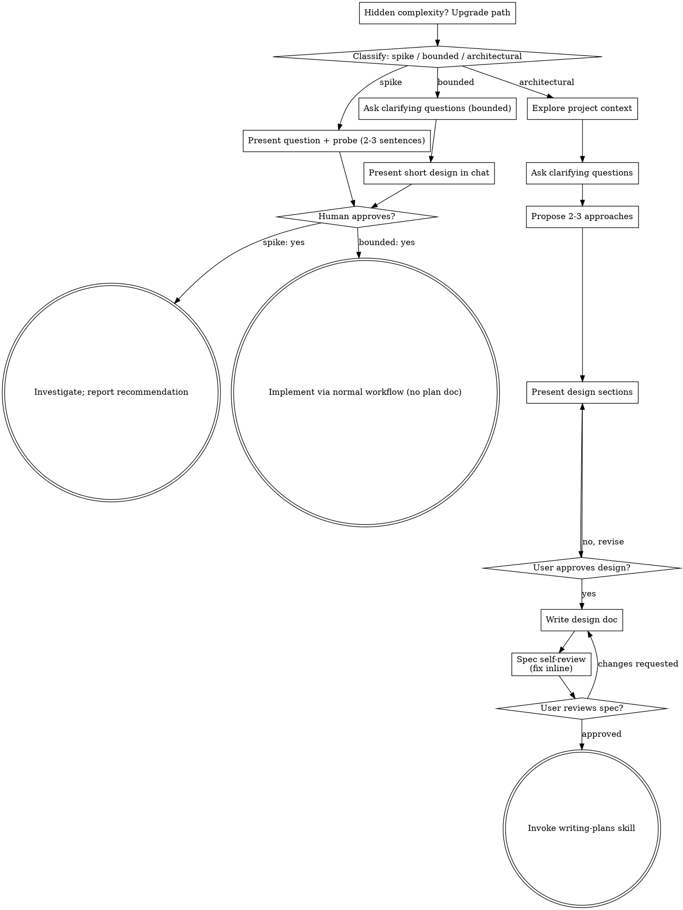

## 3 brainstorming

> 译自 `reference/superpowers/skills/brainstorming/SKILL.md`（原文 285 行）。frontmatter 与 `Process Flow` 的 dot 图按原样保留。

**frontmatter**

- `name`: `brainstorming`
- `description`: `"You MUST use this before any creative work - creating features, building components, adding functionality, or modifying behavior. Explores user intent, requirements and design before implementation."`

通过自然的协作式对话，把想法变成成形的设计与规范。

先判定这个请求需要多少流程，再顺着你选定的路径走完：理解上下文、打磨想法、呈现设计、拿到人类搭档的批准。

### 3.1 建立共识（Establish Shared Understanding）

头脑风暴的产出，是一份你的**人类搭档**能认出并纠正的理解——它扎根于他们真正想达成的东西。

1. **探明意图。** 用请求和现有上下文判断：预期结果是什么、给谁用、什么算成功。这些信息缺失时，先就问「目的/用途」问一个聚焦的问题，再去提功能或方案。知道这是哪类应用，并不等于知道搭档为什么要它。补齐缺失的需求，不等于要对方再授权一次这个任务。
2. **把理解写回去。** 用一小段话概括预期结果、相关约束和成功标准，交给搭档判断。把你**说过的**和你的**假设**分开写。邀请他纠正，并把回答并进去，之后才把它当作设计依据。
3. **把意图带进设计。** 在选定路径的设计产物里保住这份共识：架构类工作进书面 spec，有界工作和探针进对话内的设计/试探。用这份共识去检查你提的功能和技术选型。

当请求本身已经给出目的和约束时，直接复述这份理解，不要再问一遍同样的问题。这条笔记要短；它的准确性、以及「能被纠正」这两点才是要紧的。

<HARD-GATE>

在采取任何实现动作之前——包括调用实现类技能、写产品代码、搭脚手架、安装产品依赖、创建外部项目——先完成选定路径的前置条件：

- **探针（Spike）**：人类搭档批准问题与试探方案。
- **有界（Bounded）**：人类搭档批准对话内的短设计。
- **架构（Architectural）**：人类搭档审阅并批准书面 spec，然后审阅书面实施计划并选定执行方式。对话里批准设计，只授权你写 spec；批准书面 spec，只授权你调用 writing-plans。

一次回复批准的，是**当时实际呈现的那个阶段**。批准一个想法或功能范围，不等于批准尚不存在的产物。从最早的未完成阶段接着走；不要把一次批准变成跳过该路径其余步骤的许可。前置条件未完成期间，只读的项目探查是允许的。

</HARD-GATE>

### 3.2 三条路径（Three Paths）

在问第一个问题之前，先给请求分类，并把分类**说出来**——“这个看起来是有界的，所以我会在这里给一个短设计，而不是写 spec”——这样人类搭档可以推翻它：

- **探针（Spike）**——一个可行性问题（“我们能不能…”、“有没有可能…”、“糙快猛就行”），产出是一个答案，而不是要留下的代码。用 2–3 句话说明问题和你打算怎么试，点个头，然后在不牺牲正确性的前提下用最便宜的方式弄清楚。没有设计文档，没有 spec 文件。发现以建议形式汇报；做出来的任何东西都标注为一次性丢弃。
- **有界（Bounded）**——对本仓库里**已经存在**的代码做范围明确的改动：加个开关、加个小接口、单文件修复。知道这是哪类应用不够——有界意味着你要改的那条流程已经在这儿、能读到。如果不存在可改的流程，这个任务就不是有界的。问那些真正要紧的澄清问题，**在对话里**给出短设计（几句话到几小段），然后**停住**。只有人类搭档对这个设计说了「可以」，才进入实现——有界任务的批准，和架构任务一样是硬门槛。没有 spec 文件，没有实施计划文档。
- **架构（Architectural）**——新项目、新子系统、会重构组件组合方式、或改动他人依赖的接口的变更。走完整流程：提问、备选方案、分节设计、书面 spec，然后 writing-plans 技能。

在两条路径之间拿不准时，选**更重**的那条。棘轮是单向的：任务中途发现的隐藏复杂度会把路径**升级**——停下来、说出来、往上走。任务中途没有任何东西会降级。

### 3.3 反模式：「太简单，不需要批准」

每条路径都以「人类搭档在实现前批准所需设计」收尾。一个有界改动可能只需要对话里的两句话。而一个新的待办清单项目属于架构类，需要书面 spec 和计划交接。**把产物缩放到选定路径的规模**；在实现前完成该路径要求的评审。

### 3.4 危险信号（Red Flags）

| 念头 | 真相 |
|---|---|
| “这太简单了，不需要设计” | 按选定路径走：有界改动给对话内的短设计；架构改动给书面 spec 和计划交接。 |
| “我就把它叫做有界，跳过 spec” | 伸手去抓一个标签以便跳过工作，这个动作本身就是疑虑——选更重的那条路。 |
| “它有界，设计也很显然——他们边看我就边开工” | 门槛是**批准**，不是设计的长度。先呈现，然后停住，直到听见「可以」。 |
| “我懂这类应用，所以它是有界的” | 有界衡量的是**仓库**，不是你的熟悉度。新项目没有现成流程——它是架构类。 |
| “探针跑通了，所以我把代码留下” | 探针的产出是一个答案。留下代码是一个新请求——重新分类。 |
| “它长大了，但我快做完了——不必重新分类” | 隐藏复杂度会在任务中途升级路径。停下来并说出来。 |
| “他们批准了探针，那么后续改动也算批准了” | 每个任务有自己的分类、自己的批准。 |

### 3.5 检查清单（Checklist）

先分类，宣布路径，然后为你的路径上的每一项建一个任务，按顺序完成。

**探针（Spike）：**

1. **探查项目上下文**——够用来框定试探即可
2. **呈现问题 + 试探方案**——2–3 句话
3. **拿到批准**——点个头就够
4. **调查**——在不牺牲正确性的前提下尽量便宜
5. **汇报发现**——给建议；做出来的东西标注为一次性丢弃

**有界（Bounded）：**

1. **探查项目上下文**——看文件、文档、近期提交
2. **问澄清问题**——一次一个，只问要紧的
3. **在对话里给出短设计**——方案、涉及的文件、测试方式
4. **拿到批准**——**停住**，等一个明确的「可以」；把设计和开工放在同一口气里说，就是跳过门槛
5. **实现**——走正常的开发流程（TDD 照常适用）；没有计划文档

**架构（Architectural）：**

1. **探查项目上下文**——看文件、文档、近期提交
2. **按需才提供视觉同伴**——**不是**一上来就给。第一次出现某个问题「展示比描述更清楚」时，当场提供（单独一条消息）；对方同意后，浏览器标签页会为你打开。如果从头到尾没出现视觉类问题，就永远不提供。见下面的「视觉同伴」一节。
3. **问澄清问题**——一次一个，搞清目的/约束/成功标准
4. **提 2–3 个方案**——带取舍和你的推荐
5. **呈现设计**——按复杂度分节，每节之后拿用户批准
6. **写设计文档**——存到 `docs/superpowers/specs/YYYY-MM-DD-<topic>-design.md` 并提交
7. **spec 自审**——就地在对话里快速检查占位符、矛盾、歧义、范围（见下）
8. **用户审阅书面 spec**——请用户在继续之前审阅 spec 文件
9. **转入实现**——调用 writing-plans 技能生成实施计划

### 3.6 流程走向（Process Flow）

dot 图按原文保留，节点标签未译：

**终点状态与路径绑定。** 架构类：头脑风暴之后你**唯一**该调用的技能是 writing-plans——绝不是 frontend-design、mcp-builder 或任何其他实现类技能。有界类：批准之后直接走正常开发流程实现；没有计划文档。探针类：终点状态是一份汇报出来的建议。

### 3.7 过程（The Process）

下面各小节服务有界路径和架构路径（探针在「呈现试探方案、拿到点头」就结束了）。从**探索方案**开始往后，是架构路径才有的深度——有界工作就是「上下文 + 几个问题 + 对话内短设计」这么全套。

**理解想法：**

- 先看当前项目状态（文件、文档、近期提交）
- 问细节问题之前先评估范围：如果请求描述了多个互相独立的子系统（例如「做一个带聊天、文件存储、计费和分析的平台」），立刻指出来。不要花问题去打磨一个首先需要被拆解的项目。
- 如果项目大到一份 spec 装不下，帮用户拆成子项目：哪些是独立部分、它们怎么关联、按什么顺序做？然后把第一个子项目走正常流程做头脑风暴。每个子项目有自己的 spec → 计划 → 实现循环。
- 对范围合适的项目，一次问一个问题来打磨想法
- 尽量用选择题，开放性提问也可以
- **每条消息只放一个问题**——某个话题需要展开，就拆成多个问题
- 聚焦于理解：目的、约束、成功标准

**探索方案：**

- 提 2–3 个不同方案，带取舍
- 用对话方式呈现选项，附你的推荐与理由
- 把你推荐的选项放在最前面并解释原因
- 无情地执行 YAGNI——从每个方案和设计里删掉不必要的功能

**呈现设计：**

- 当你确信自己理解了要造什么，就呈现设计
- 每节按复杂度缩放：简单就几句话，微妙的可以到 200–300 字
- 每节之后问一句「到这里看着对吗」
- 覆盖：架构、组件、数据流、错误处理、测试
- 有讲不通的地方，随时准备回去澄清

**为隔离与清晰而设计：**

- 把系统拆成更小的单元，每个单元只有一个明确用途，通过定义良好的接口通信，并且能被独立理解和测试
- 对每个单元，你应该能回答：它做什么、怎么用它、它依赖什么？
- 别人不读内部实现，能明白这个单元做什么吗？你能改内部而不弄坏调用方吗？如果不能，边界就需要返工。
- 更小、边界清晰的单元对你干活也更友好——一次能拿在上下文里的代码，你推理得更好；文件聚焦时，你的改动更可靠。文件变大，往往说明它做的事太多了。

**在既有代码库里工作：**

- 提改动之前先探查当前结构。遵循既有模式。
- 既有代码里有影响这次工作的问题（比如文件已经过大、边界不清、职责纠缠），把针对性的改进纳入设计——就像一个好开发者会顺手改善他正在动的代码。
- 不要提无关的重构。只做服务于当前目标的事。

### 3.8 设计之后（架构路径）（After the Design）

**文档：**

- 把经过验证的设计（spec）写到 `docs/superpowers/specs/YYYY-MM-DD-<topic>-design.md`
  - （用户对 spec 存放位置的偏好覆盖这个默认值）
- 如果有 `elements-of-style:writing-clearly-and-concisely` 技能，就用它
- 把设计文档提交到 git

**spec 自审：**

写完 spec 之后，用新鲜的眼光看它一遍：

1. **占位符扫描：** 有没有 "TBD"、"TODO"、未完成的章节、含糊的需求？修掉。
2. **内部一致性：** 有没有章节互相矛盾？架构和功能描述对得上吗？
3. **范围检查：** 它是否足够聚焦、能由一份实施计划完成？还是需要拆解？
4. **歧义检查：** 有没有需求能被理解成两种意思？有就选定一种并写明确。

就地修掉。不需要再审一遍——改完就走。

**用户评审门槛：**

spec 自审循环通过后，在继续之前请用户审阅写好的 spec：

> 译文：「spec 已写好并提交到 `<path>`。请审阅，并在我们开始写实施计划之前告诉我是否要改。」
>
> 原文：`"Spec written and committed to `<path>`. Please review it and let me know if you want to make any changes before we start writing out the implementation plan."`

等用户回复。如果要求修改，就改并重跑 spec 自审循环。只有用户批准后才能继续。

**实现：**

- 调用 writing-plans 技能生成详细的实施计划
- **不要**调用任何其他技能。writing-plans 就是下一步。

### 3.9 视觉同伴（Visual Companion）

一个基于浏览器的同伴，用于在头脑风暴期间展示原型图、示意图和视觉选项。它是一个**工具**，不是一种模式。接受这个同伴，意味着它可用于那些受益于视觉呈现的问题；**不**意味着每个问题都走浏览器。

**提供同伴（按需，just-in-time）：** 不要一上来就提供。等到某个问题确实「展示比讲述更清楚」时再说——是真的原型图/布局/示意图问题，而不只是 UI 这个**话题**。第一次出现这种情况时，当场提供，并且单独作为一条消息：

> 译文：「接下来这部分我直接展示给你可能更容易——我可以在浏览器标签页里边聊边做原型图、示意图和对比。它还挺新的，而且比较费 token。要我开吗？我来帮你打开。」
>
> 原文：`"This next part might be easier if I show you — I can put together mockups, diagrams, and comparisons in a browser tab as we go. It's still new and can be token-intensive. Want me to? I'll open it for you."`

**这个提供必须是单独一条消息。** 只放这个提供——不要夹带澄清问题、总结或其他内容。等用户回复。如果他接受，用 `--open` 启动服务器，让他的浏览器自动打开到第一屏。如果拒绝，继续纯文本，不要再提，除非他自己提起。

**逐个问题判断：** 即使对方已经接受，也要**对每个问题**单独决定走浏览器还是走终端。判据是：**用户看见它，会比读它更明白吗？**

- **用浏览器**呈现本身就是视觉的内容——原型图、线框图、布局对比、架构图、并排的视觉设计
- **用终端**呈现文本内容——需求问题、概念选择、取舍清单、A/B/C/D 文字选项、范围决定

关于 UI 话题的问题，不自动等于视觉问题。「在这个语境里 personality 是什么意思？」是概念问题——用终端。「哪个向导布局更好？」是视觉问题——用浏览器。

如果他同意使用同伴，继续之前先读详细指南：`skills/brainstorming/visual-companion.md`

### 3.10 读后思考

同样只记「它有什么」，没到取舍阶段。

- **判据是可查证的。** bounded 的量尺是仓库里有没有现成流程，不是你的熟悉度。
- **分类要说出口。** 它是可被推翻的提议，不是内部状态。
- **降级的是产物，不是门槛。** 产物可缩到 2–3 句话，批准门槛一样硬。
- **批准不许外推。** 批设计只给 spec，批 spec 只给 writing-plans。
- **棘轮单向。** 中途发现隐藏复杂度就升级，没有任何东西会降级。
- **YAGNI 和棘轮方向相反。** 一个砍功能范围，一个加流程重量。
- **反模式查的是动机。** 不只是「我想跳过」，而是「我为什么选这个标签」。
- **每个法都有终点。** 架构路径走完只许调 writing-plans，不许顺手开工。
- **可选工具有出场规则。** 视觉同伴：按需提议、独立成条、先报成本、拒绝不再提。
- **留白：阶段判定没有外部状态。** HARD-GATE 是嘱咐，不是闸机。
- **留白：「拿不准选更重」只往一边偏。** 短期防漏，长期累积流程膨胀。
