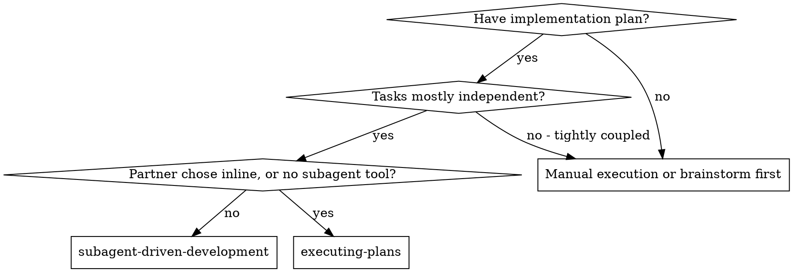
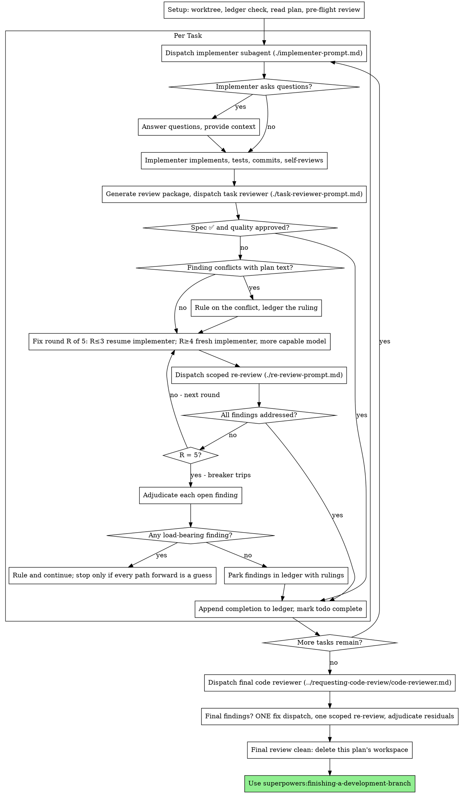

## 6 subagent-driven-development

> 译自 `reference/superpowers/skills/subagent-driven-development/SKILL.md`（原文 568 行）。frontmatter 与三段代码块（两张 dot 图、`Example Workflow` 示例会话）按原样保留。
> 对照 `READING-superpowers.md` 第 07 项。

**frontmatter**

- `name`: `subagent-driven-development`
- `description`: `Use when executing implementation plans with independent tasks in the current session`

通过**每个任务派发一个全新的实现者子智能体、每个任务之后做一次任务评审（spec 合规 + 代码质量）、最后再做一次整分支的宽评审**来执行计划。

**为什么用子智能体：** 你把任务委派给上下文隔离的专用 agent。通过精确构筑它们的指令与上下文，你保证它们保持专注、完成任务。它们**绝不继承你会话的上下文或历史**——你亲手构造它们正好需要的东西。这同时保住了你自己的上下文，用来做协调工作。

**核心原则：** 每任务一个新子智能体 + 任务评审（spec + 质量）+ 最终宽评审 = 高质量、快速迭代

**叙述（Narration）：** 工具调用之间，最多只叙述一行短句——记录由账本和工具结果承担。

**连续执行：** 任务之间**不要**停下来跟人类搭档确认。把计划里的任务一口气执行完。停下来的理由只有下面那四条，或者所有任务已完成。“要我继续吗？”这类询问和进度汇报是在浪费他们的时间——他们请你执行计划，那就执行。

**裁决，而不是停摆。** 一份正在跑的计划不等人类。冲突、歧义、计划缺陷、一个你本来要去申请突破的上限——都由你**裁决**。spec 是有约束力的权威，计划是它的论证，你的判断解决两者都没回答的部分。每个决定都记进账本：`Ruling: <你决定了什么> — <为什么> — <错了要付什么代价>`，然后继续。一个错判的代价是搭档看得见、也撤得掉的返工；一个卡在问题上的会话，代价是他的一整天，而且什么也没换来。

只有四件事能让你停下，且仅此四件：不可逆或破坏性操作；安全敏感动作；**这个 worktree 之外**、按惯例要先问的副作用（合并、推送到共享分支、发布）；以及一份坏到「每条前路都是猜」的计划。遇上这四类，停下来问。

### 6.1 何时使用（When to Use）



**对比 Executing Plans（内联）：**

- 每任务一个全新子智能体（无上下文污染），而不是一份上下文干完所有任务
- 每个任务之后都评审（spec 合规 + 代码质量），而不是只在最后评审一次
- 代价是每个任务、每次评审都吃一份全新上下文；内联是一份上下文加一个最终评审者
- 两者都在本会话里跑，共享同一份计划工作区和账本，任务之间都绝不停顿

### 6.2 流程（The Process）



### 6.3 准备（Setup）

确保工作发生在隔离的工作区里：用 superpowers:using-git-worktrees 创建一个，或确认已存在的那个。**没有人类搭档的明确同意，绝不在 main/master 分支上开始实现。**

对话记忆熬不过上下文压缩。在真实会话里，丢失了进度的控制器**重新派发过整个已完成的任务序列**——这是观察到的最昂贵的失败。**用账本文件追踪进度，不要只靠 todo。**

- 每份计划拥有一个工作区：技能开始时运行本技能的 `bash scripts/sdd-workspace PLAN_FILE`——它会打印这份计划被 git 忽略的目录（在 `<repo-root>/.superpowers/sdd/` 下），这里是**本计划**全部产物的家：账本、简报、报告、评审包。别的计划的目录永远不归你读或写。
- 在 `<workspace>/progress.md` 检查本计划的账本。如果它的第一行写的是你的计划文件，那么带 `Task <N>: complete` 行的任务已经**完成**——不要重新派发；从第一个没有这行的任务接着做。某任务最后一行是修复轮次的，说明它正在循环中：从下一轮接着跑。第一行写的是**另一个**计划文件——或者旧扁平路径 `.superpowers/sdd/progress.md` 上有个游离账本——那是别的计划的进度：**原地留着**，自己另起一个全新的。
- 创建账本，第一行写它的身份：`# SDD ledger — plan: <plan file path>`。
- 账本是你的恢复地图：它点名的提交在 git 里真实存在，哪怕你的上下文已经不记得创建过它们。压缩之后，**信账本和 `git log`，不要信自己的回忆**。
- `git clean -fdx` 会毁掉工作区（它是被忽略的暂存区）；真发生了，就从 `git log` 恢复。

把计划读一遍，记下它的上下文和 Global Constraints，为每个任务建一个 todo。如果计划指名了 Spec，也把它读了：**spec 是计划据以论证的权威**，计划内部的冲突以它为准。拿不到 spec 的计划要在账本里记一笔说明——没有 spec 时做出的裁决都是**临时的**。

派发 Task 1 之前，把计划扫一遍找冲突，边查边写下你查了什么：

- 互相矛盾的任务，或与计划的 Global Constraints 矛盾的任务
- 计划明确要求、而评审标准视为缺陷的东西（不 assert 任何东西的测试、逻辑块的逐字复制）

**扫描的产出是一张表，不是一个结论。** 每一对共享文件或接口的任务占一行：哪两个任务、一个产出什么对应另一个消费什么、你发现了什么。每个任务各占一行：它自己的文本是否自洽——它指定的测试对应它指定的代码、它创建的文件对应它后面改动的文件。没有这些行，「扫描是干净的」就不是一次真的扫描。

把表写进账本。**在执行开始之前**对你发现的一切做出裁决——每一条发现都对着要求它的计划原文——并把每条裁决记进账本。扫描干净就直接开始，不用多话。对扫描出的每个冲突做出裁决——spec 是有约束力的权威，计划是它的论证——把裁决记在对应行旁边，然后派发 Task 1。评审循环仍然是「只在实现阶段才浮现的冲突」的兜网。

### 6.4 模型选择（Model Selection）

用能胜任每个角色的**最弱**模型，以省成本、提速度。

**机械实现任务**（孤立函数、清晰 spec、1–2 个文件）：用快而便宜的模型。计划写得好时，大多数实现任务都是机械的。

**集成与判断任务**（多文件协调、模式匹配、调试）：用标准模型。

**架构与设计任务**：用可用的最强模型。最终整分支评审就属于这一类——用可用的最强模型派发，不要用会话默认值。

**评审任务**：用同样的判断挑模型，按 diff 的大小、复杂度、风险缩放。小的机械 diff 不需要最强模型；微妙的并发改动需要。小的修复 diff 的范围化复审用便宜到中档。

**修复循环升级（第 4–5 轮）**：用至少比卡住的那位实现者高一档的模型。

**派发子智能体时永远显式指定模型。** 省略模型会继承你会话的模型——往往是最强也最贵的那个——这会**悄悄废掉这一整节**。

**轮数胜过 token 单价。** 墙钟时间和上下文成本随子智能体花多少轮而变，而最便宜的模型在多步工作上常要花 2–3 倍的轮数——总体反而更贵。**把中档模型当作评审者、以及「照着散文式描述干活」的实现者的下限。** 当任务的计划文本里含完整待写代码时，实现就是「抄写 + 测试」：那种实现者用最便宜的一档。单文件机械修复也用最便宜的一档。

**任务复杂度信号（实现任务）：**

- 触碰 1–2 个文件且 spec 完整 → 便宜模型
- 触碰多个文件且有集成问题 → 标准模型
- 需要设计判断、或对代码库的广泛理解 → 最强模型

### 6.5 任务循环（The Task Loop）

**把小批同形工作打包。** 当计划列出若干任务，每个都是同一种小而独立的改动——同一处一行修复、同一个常量改动、同一个字段新增，在多个文件里重复——**不要**每任务派一个子智能体。**编一份派发简报**，列出每个文件和它的改动，整批发给一个子智能体，把它的 diff 当作一个单位评审。把「一派一任务」留给那些需要自己的判断、自己的测试、或自己的评审面的工作。

你粘进派发提示词的一切——以及子智能体打印回来的一切——都会在**本会话剩下的时间里常驻你的上下文**，并在之后每一轮被重读。产物要以**文件**形式交接。

**等待被派发的子智能体：** 永远不要用短超时轮询等待接口，也不要干坐着做一次无声、无期限的等待。手上有本地活时——更新账本、打包下一份评审、读报告——就继续干；子结果会自己回来。当你真的空下来，就**分小段等待**（平台允许的话，五到十分钟一段），每段之间发一行状态并核对活着的子智能体：列出来，对有结果却没报告的进行追问。分小段等待保住了长等待几乎全部的效率，又能保证一个卡住或丢失的子智能体在几分钟内被发现，而不是等到会话结束。

#### 6.5.1 派发实现者（1. Dispatch the implementer）

派发之前记录 BASE（`git rev-parse HEAD`）——评审包和修复轮 diff 都要用它。

- **任务简报：** 派发实现者之前，运行本技能的 `bash scripts/task-brief PLAN_FILE N`——它把任务的完整文本提取到一个唯一命名的文件并打印路径。把派发组织成「简报是需求的唯一来源」。你的派发里应当包含：(1) 一行说明这个任务在项目中的位置；(2) 简报路径，并说明「先读这个——它是你的需求，里面有要逐字使用的确切取值」；(3) 简报不可能知道的、来自前面任务的接口与决定；(4) 你对简报里注意到的歧义的裁定；(5) 报告文件路径与报告契约。确切的取值（数字、魔法字符串、签名、测试用例）只出现在简报里。**绝不要让子智能体去读整份计划文件。**
- **报告文件：** 实现者的报告文件按简报命名（简报 `…/task-N-brief.md` → 报告 `…/task-N-report.md`），并把路径放进派发提示词。实现者把完整报告写在那里，只回传状态、提交、一行测试摘要和顾虑。
- 一份派发提示词描述**一个任务**，不是本会话的历史。不要把累积的前序任务摘要（「Tasks 1-3 之后的状态」）粘进后面的派发——真实会话里有一份派发到了 42k 字符，其中 99% 是粘贴的历史。全新的子智能体需要的是：它的任务、它触碰的接口、以及全局约束。别的都不要。
- 派发携带**禁止再派子智能体**的契约（在实现者模板里）：实现者绝不派发子智能体——不派帮手，更绝不派评审者。评审由你、在报告之后派发。真实会话里，worker 自己生的评审者**每一个都重复了**控制器本来就会派的任务评审——等于每个任务白多一个评审席位。
- 如果早先的任务在这个任务触碰的区域里搁置过一条发现，在派发里带上指向那条账本记录的指针。
- 从派发结果里记下实现者的 agent 身份——修复循环第 1–3 轮要恢复这个 agent。
- 绝不并行派发多个实现子智能体（会冲突）。

模板：[implementer-prompt.md](implementer-prompt.md)

#### 6.5.2 处理报告（2. Handle the report）

实现者子智能体回报四种状态之一。各按相应方式处理：

**DONE：** 生成评审包（从本技能目录运行 `bash scripts/review-package PLAN_FILE BASE HEAD`——它打印它写出的唯一文件路径；BASE 是你派发实现者之前记录的提交——**绝不用 `HEAD~1`**，那会悄悄丢掉多提交任务里除最后一个之外的全部提交），然后用打印出的路径派发任务评审者。

**DONE_WITH_CONCERNS：** 实现者完成了工作，但标出了疑虑。继续之前先读这些顾虑。如果顾虑关乎正确性或范围，在评审之前处理。如果只是观察（比如「这个文件在变大」），记下并进入评审。

**NEEDS_CONTEXT：** 实现者需要未提供的信息。补上缺失的上下文并重新派发。

**BLOCKED：** 实现者无法完成任务。评估阻塞：

1. 如果是上下文问题，补更多上下文，用同一个模型重新派发
2. 如果任务需要更多推理，换更强的模型重新派发
3. 如果任务太大，拆成更小的块
4. 如果计划本身是错的，对修正做出裁决、记账本，并把裁决带在派发里重新派发

**绝不**忽视一次上报，也绝不逼同一个模型不改任何东西地重试。如果实现者说它卡住了，那就得有一处发生变化。

如果实现者提问——无论开工前还是任务中途——清楚完整地回答，需要时补上下文，**不要催它进入实现**。

#### 6.5.3 评审任务（3. Review the task）

每任务评审是**任务范围的闸门**。宽评审只做一次，在最终整分支评审时。绝不跳过任务评审，也绝不接受缺任何一个裁定的报告——**spec 合规和任务质量两者都必须有**。实现者的自审永远不能替代任务评审；两者都需要。

- 把 diff 以文件交给评审者：运行本技能的 `bash scripts/review-package PLAN_FILE BASE HEAD`，把它打印的文件路径传给评审者（没有 bash 时：`git log --oneline`、`git diff --stat`、`git diff -U10` 覆盖该范围，重定向到一个唯一命名的文件）。输出永远不进你自己的上下文，而评审者一次 Read 就能拿到提交列表、统计摘要和带上下文的完整 diff。用你派发实现者之前记录的 BASE——**绝不用 `HEAD~1`**，它会悄悄截断多提交任务。**没有 diff 文件就不要派发任务评审者。**
- **评审者的输入：** 任务评审者拿到三个路径——同一份简报文件、报告文件、评审包——加上约束该任务的全局约束。
- 你交给评审者的全局约束块是它的**注意力透镜**。从计划的 Global Constraints 一节、或 spec 里**逐字**抄下那些有约束力的要求：确切的取值、确切的格式、以及被明确声明的组件间关系（「和 X 同布局」「与 Y 匹配」）。评审者的模板本身已经带了流程规则（YAGNI、测试卫生、评审方法）——约束块是给「**这个**项目的 spec 要求了什么」用的。
- 没有具体的、针对该任务的理由，不要加「检查所有用法」「如果有用就跑竞态测试」这类开放式指令
- 不要让评审者重跑实现者已经在同一份代码上跑过的测试——实现者的报告携带测试证据
- **不要替评审者预判发现**——绝不指示评审者忽略或不要标出某个具体问题。如果你认为某条发现会是误报，让评审者提出来，在评审循环里裁决。如果你正在写的提示词里出现「不要标出」「不要把 X 当作缺陷」「最多算 Minor」「计划选择了」——**停手：你在预判，通常是为了给自己省掉一轮评审。**
- 任务评审者可能报出「⚠️ 无法从 diff 核实」的条目——那些活在未改动代码里、或跨任务的需求。它们不阻塞评审的其余部分，但你在把任务标记为完成之前必须**自己**逐条解决：你手里有评审者缺少的计划与跨任务上下文。如果你确认某条是真的缺口，就当它是 spec 评审失败——它和其他发现一起进入修复循环。

模板：[task-reviewer-prompt.md](task-reviewer-prompt.md)

#### 6.5.4 修复循环（4. The fix loop）

当评审报出 spec ❌、任何 Critical 或 Important 发现，或你确认为真实缺口的 ⚠️ 条目时，循环触发。

循环开始前，有两条路线会立刻离开循环：

- 边做边把 Minor 发现记进进度账本（`Task <N>: minor (deferred): <一句话>`），并把最终整分支评审指向这份清单，让它分诊哪些必须在合并前修掉。**没人读的汇总等于静默丢弃。** Minor 发现永远不进循环。
- 标为 plan-mandated 的发现——或任何与计划原文要求冲突的发现——由你裁决：把发现和计划原文放在一起权衡，以 spec 为有约束力的权威做出决定，在行动之前把裁决记进账本。不要因为「计划就是这么要求的」就驳回它，也不要在没有记录裁决的情况下派发一个与计划相悖的修复。

其余一切进入循环。**一轮修复 = 一次修复派发 + 一次范围化复审。** 每个任务最多五轮：

**第 1–3 轮——恢复原来的实现者。** 把未决发现**逐字**发给它。它的上下文还完整：它了解这个任务、这份代码、以及它自己的选择。如果你的 Harness 无法再给一个活着的子智能体发消息，就派一个全新实现者，带上简报路径、报告文件路径和发现清单——**两种情况下报告文件都是持久记忆**。

**第 4–5 轮——换更强的模型派一个全新实现者**（按 Model Selection），带上简报路径、报告文件路径、未决发现，以及这段话术：「此前有一位实现者尝试过这个任务 [N] 次；现在归你。读报告文件了解试过什么。」 一个扛过三次恢复的循环，通常意味着实现者看不见自己的问题——**新眼睛和能力上调，一步到位**。

**每一轮，无论哪条路：** 实现者修复、重跑覆盖被改代码的测试、把修复报告追加到同一个报告文件、回传那份简短契约。重新派发评审者之前，确认修复报告里有覆盖测试、跑的命令、以及输出；三者齐了再派复审。在修复消息里点名覆盖的测试文件——一处一行的修复不需要整个测试套件。

**复审是范围化的。** 运行 `bash scripts/review-package PLAN_FILE FIX_BASE HEAD`，其中 FIX_BASE 是上一次评审看到的 head，然后用发现清单、简报、报告文件和打印出的 diff 路径派发 [re-review-prompt.md](re-review-prompt.md)。复审者对每条发现给出 ADDRESSED 或 NOT ADDRESSED，并且**只在修复 diff 里**标出新破坏。修复 diff 里新的 Critical/Important 破坏并入未决发现清单。超出范围的观察进账本作为 deferred minor——它们永远不延长循环。

**每一轮之后**，往账本追加：
`Task <N>: fix round <R>/5 (<X> addressed, <Y> open — <发现一句话>; commits <a7>..<b7>)`

**绝不要在控制器会话里自己修发现**——你的上下文要保持干净以做协调，而且控制器自己动手的修复会跳过评审。

**断路器。** 当第 5 轮的复审仍然留下未决发现，停止派发。**自己**逐条裁决未决发现——你手里有评审者缺少的计划与跨任务上下文：

- **评审者错了，或这一点可争议：** 搁置它——`Task <N>: parked — <发现> — Ruling: <为什么这段代码站得住>`。最终评审会看到双方。
- **是真的，但下游没有任何东西依赖它：** 同样方式搁置，裁决里写明「是真的，推迟」。
- **是真的且承重**——后面的任务建立在它之上，或它暴露了一个计划缺陷：对「能解锁依赖工作的最小改动」做出裁决，记为 `Task <N>: Ruling: <发现> — <你决定了什么以及为什么>`，并把它带进下一个任务的派发。静默搁置一个结构性失败，会让每一个依赖它的任务都建在它上面。只有当缺陷让**每条前路都成为猜测**时才停下。

**只在到达上限时裁决。** 提前裁决以结束循环，是「预判」换了个名字。每次裁决都是一条账本记录——**静默丢弃是被禁止的**。

#### 6.5.5 完成任务（5. Complete the task）

当评审干净返回——或者每条未决发现都在上限处带着裁决被搁置——把完成行追加到账本，和你的其他记账动作放在同一条消息里：

- `Task <N>: complete (commits <base7>..<head7>, review clean)`
- `Task <N>: complete (commits <base7>..<head7>, <K> parked)`（断路器跳闸之后）

然后标记 todo 完成，继续。**在评审还有未修复、也未在上限处带裁决搁置的 Critical/Important 问题时，绝不进入下一个任务。**

### 6.6 最终评审（Final Review）

最终整分支评审也拿一份包：运行 `bash scripts/review-package PLAN_FILE MERGE_BASE HEAD`（MERGE_BASE = 分支起点那个提交，例如 `git merge-base main HEAD`），把打印出的路径放进最终评审派发里，这样最终评审者读**一个文件**，而不是用 git 命令重新推导分支 diff。用可用的最强模型派发（见模型选择），使用 superpowers:requesting-code-review 的 [code-reviewer.md](../requesting-code-review/code-reviewer.md)。把它指向账本里的 deferred-minor 行和 parked 行，让它分诊哪些必须在合并前修掉。

如果最终整分支评审返回发现，用**完整发现清单派发一个**修复子智能体——不是每条发现一个修复者。逐发现修复者各自重建上下文、各跑一遍套件；真实会话里有一波最终评审修复，**花费超过了它所有任务的总和**。然后对那一波修复**恰好做一次**范围化复审（对修复范围跑 `bash scripts/review-package PLAN_FILE FIX_BASE HEAD`，配 [re-review-prompt.md](re-review-prompt.md)）。残余发现按任务循环里断路器的方式裁决：带着裁决搁置，或对承重的那些做出裁决并记录你决定了什么。**只有上面那四类能让你在这里停下。没有第二波修复**——残余的承重发现会在 finishing-a-development-branch 呈现选项时浮到人类搭档面前。

### 6.7 收尾（Finish）

删任何东西之前，把账本里每一条含 `Ruling:` 的行——预检裁决、搁置的发现、断路器裁决，全部——按你做出的顺序收进最终消息的「我做过的裁决」标题下，每条写明错了要付什么代价。**这份清单是穷尽的**：账本里有裁决，清单里就要有。那份清单是你替人类搭档做出的决定**唯一**抵达他们的地方——他们读它，并把你弄错的重做。**一条随工作区一起消失的裁决，等于一个秘密做出的决定。**

当最终整分支评审干净、它的修复也合并了，删除本计划的工作区（`rm -rf <workspace>`）——git 历史现在就是记录。兄弟目录属于别的计划；别碰。

使用 superpowers:finishing-a-development-branch。

### 6.8 常见合理化（Common Rationalizations）

| 借口 | 真相 |
|---|---|
| “spec 合规上差不多就行了” | 评审者找到了 spec 缺口 = 没完成。修，或者到上限裁决——那是仅有的出口。 |
| “我自己修吧，派发是额外开销” | 控制器自己动手会污染你的上下文且跳过评审。恢复实现者。 |
| “再来一轮就收敛了” | 过了上限，轮次不会收敛——失败是结构性的。裁决并改道。 |
| “反正评审者总能找出新东西” | 范围化复审只核实修复，不能游荡。未改动代码上的新发现进账本，不进循环。 |
| “这条发现明显是错的，我丢掉” | 你只在上限处裁决，而且每条裁决都是一条账本记录。静默丢弃是被禁止的。 |
| “修复很小，跳过复审” | 未评审的修复正是回归落地的方式。每一轮都以范围化复审收尾。 |
| “评审会拖慢循环” | 没有评审的循环只是未经验证的瞎忙。评审是循环的刹车和转向。 |
| “账本记账是额外开销” | 账本是压缩后活下来的东西。没有账本的控制器重新派发过整个已完成的任务序列。 |
| “实现者自己生了个评审者——免费多一道保障” | 那是重复席位在评审同一份 diff；任务评审才是闸门。worker 自生的评审者是要标出的缺陷，不是严谨。 |

### 6.9 示例工作流（Example Workflow）

示例会话原文保留，未译：

```
You: I'm using Subagent-Driven Development to execute this plan.

[Setup: worktree verified]
[Read plan file once: docs/superpowers/plans/feature-plan.md]
[Resolve workspace: bash scripts/sdd-workspace docs/superpowers/plans/feature-plan.md — no ledger inside, fresh start]
[Create todos for all tasks]

Task 1: Hook installation script

[Run task-brief for Task 1; dispatch implementer with brief + report paths + context]

Implementer: "Before I begin - should the hook be installed at user or system level?"

You: "User level (~/.config/superpowers/hooks/)"

Implementer: [Later]
  - Implemented install-hook command
  - Added tests, 5/5 passing
  - Self-review: Found I missed --force flag, added it
  - Committed

[Run review-package PLAN_FILE BASE HEAD; dispatch task reviewer with the printed path]
Task reviewer: Spec ✅ - all requirements met, nothing extra.
  Strengths: Good test coverage, clean. Issues: None. Task quality: Approved.

[Ledger: Task 1: complete (commits a1b2c3d..d4e5f6a, review clean)]

Task 2: Recovery modes

[Run task-brief for Task 2; dispatch implementer with brief + report paths + context]

Implementer: [No questions]
  - Added verify/repair modes
  - 8/8 tests passing
  - Committed

[Run review-package PLAN_FILE BASE HEAD; dispatch task reviewer with the printed path]
Task reviewer: Spec ❌:
  - Missing: Progress reporting (spec says "report every 100 items")
  Issues (Important): Magic number (100)

[Fix round 1: resume the implementer with both findings]
Implementer: Added progress reporting, extracted PROGRESS_INTERVAL constant.
  Re-ran test/recovery.test.js — 10/10 passing. Fix report appended.

[Run review-package PLAN_FILE FIX_BASE HEAD; dispatch scoped re-review]
Re-reviewer: Missing progress reporting — ADDRESSED (src/recovery.js:41).
  Magic number — ADDRESSED (src/recovery.js:7). New breakage: none.
  Verdict: all findings addressed.

[Ledger: Task 2: fix round 1/5 (2 addressed, 0 open; commits d4e5f6a..b7c8d9e)]
[Ledger: Task 2: complete (commits d4e5f6a..b7c8d9e, review clean)]

...

[After all tasks]
[Run review-package PLAN_FILE MERGE_BASE HEAD; dispatch final code-reviewer, most capable model]
Final reviewer: All requirements met. Deferred minors triaged: none block merge.

[Delete this plan's workspace — the record now lives in git]

Done! Using superpowers:finishing-a-development-branch.
```
