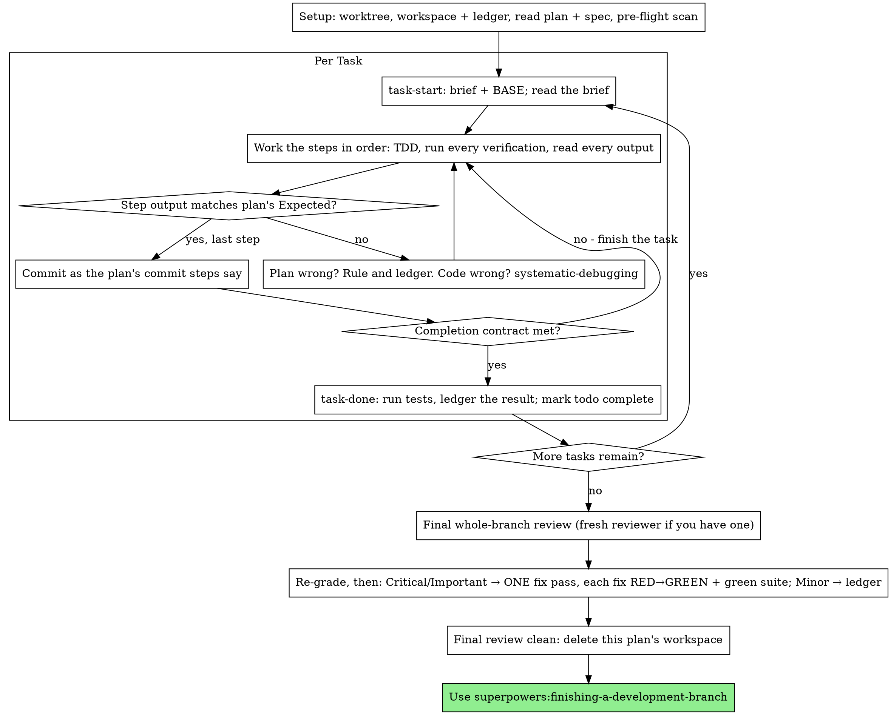

## 10 executing-plans

> 译自 `reference/superpowers/skills/executing-plans/SKILL.md`（原文 373 行）。frontmatter 与两段代码块（`The Process` 的 dot 图、`Example Workflow` 示例会话）按原样保留。
> 对照 `READING-superpowers.md` 第 11 项。

**frontmatter**

- `name`: `executing-plans`
- `description`: `Use when executing an implementation plan in the current session as the implementer yourself — your human partner chose inline execution, or no subagent tool is available`

在本会话里，你自己、逐任务地执行这份计划：没有每任务一个实现者子智能体，也没有每任务一位评审者。整条分支只在最后做一次全新上下文的评审。

**为什么内联：** 子智能体驱动开发要为每个任务付出一个全新实现者和一位全新评审者的代价，而它们每一个都要从零重读代码库。内联执行只付一份上下文（你的）加最后一位评审者。它放弃的是每任务一份全新上下文、以及每任务第二双眼睛。本技能用别的手段保住那两样东西买来的东西：简报即 spec，账本即你的记忆，TDD 是每任务的门禁，最终评审者就是那第二双眼睛。

**核心原则：** 计划已经做完了思考。严格照它执行，用「你亲眼看着先失败、再通过」的测试来证明每一步，并留下一条能熬过你自己遗忘的记录。

**叙述（Narration）：** 工具调用之间，最多只叙述一行短句——记录由账本和工具结果承担。

**连续执行：** 任务之间**不要**停下来跟人类搭档确认。他们选内联执行是为了少花钱，不是为了在每个任务之后回答「要我继续吗？」。把计划里的任务一口气执行完，不要停。

**裁决，而不是停摆。** 冲突、歧义、计划缺陷——都由你**裁决**。spec 是有约束力的权威，计划是它的论证，你的判断解决两者都没回答的部分。每个决定都记进账本：`Ruling: <你决定了什么> — <为什么> — <错了要付什么代价>`，然后继续。偏离计划却没有记账本裁决，就是一个秘密做出的决定。

只有四件事能让你停下，且仅此四件：不可逆或破坏性操作；安全敏感动作；**这个 worktree 之外**、按惯例要先问的副作用（合并、推送到共享分支、发布）；以及一份坏到「每条前路都是猜」的计划。遇上这四类，停下来问。

### 10.1 何时使用（When to Use）

- 你有一份来自 superpowers:writing-plans 的计划，并且你的人类搭档在交接时选择了内联执行。
- 你的 Harness 没有子智能体工具（见 `../using-superpowers/references/` 里各平台的参考文档）。绝不要伪造一次派发；就在这里跑这份计划。
- 任务大体相互独立——与 superpowers:subagent-driven-development 同一个前提条件。

一份完整明确的计划让内联执行变成「抄写 + 测试」：它在中档会话模型上跑得很好，而最强模型唯一值回成本的地方是最终评审——本技能把它单独派发。当他们选择内联时，把这一点告诉你的人类搭档。

当你的人类搭档想对每个任务都有评审门禁，或者计划长到它的后段任务会在被压缩过的上下文上执行时，优先用 superpowers:subagent-driven-development。对一份长计划做内联执行仍然可行——账本正是让它可恢复的东西——但最后那些任务得到的是最少的你。

### 10.2 流程（The Process）



### 10.3 准备（Setup）

确保工作发生在隔离的工作区里：用 superpowers:using-git-worktrees 创建一个，或确认已存在的那个。**没有人类搭档的明确同意，绝不在 main/master 分支上开始实现。**

对话记忆熬不过上下文压缩。一个丢失了位置的内联执行者会重新实现那些提交已经存在的任务——这和控制器重新派发它们是同一种失败，只是代价付在你自己的上下文上。**在账本文件里追踪进度，不要只放在 todo 里。** Harness 的 todo 是实时视图；账本是记录。

工作区和账本与 superpowers:subagent-driven-development 共用——同一个目录、同一种格式——所以一份计划可以在执行中途换执行者，新的执行者从同一个账本接着做。

- 每份计划拥有一个工作区：技能开始时运行 `../subagent-driven-development/scripts/sdd-workspace PLAN_FILE`——它会打印这份计划被 git 忽略的目录（`<repo-root>/.superpowers/sdd/<plan-basename>/`），这里是**本计划**全部产物的家：账本、简报、评审包。别的计划的目录永远不归你读或写。
- 在 `<workspace>/progress.md` 检查本计划的账本。如果它的第一行写的是你的计划文件，那么带 `Task <N>: complete` 行的任务已经**完成**——不要重做；从第一个没有这行的任务接着做。它们的提交在 git 里真实存在，哪怕你的上下文已经不记得做过它们：压缩之后，信账本和 `git log`，不要信自己的回忆。第一行写的是**另一个**计划文件的账本，那是别的计划的进度：原地留着，自己另起一个全新的。
- 创建账本，第一行写它的身份：`# SDD ledger — plan: <plan file path>`。
- `git clean -fdx` 会毁掉工作区（它是被 git 忽略的暂存区）；真发生了，就从 `git log` 恢复。

把计划读一遍，记下它的上下文和 Global Constraints，为每个任务建一个 todo。如果计划指名了 Spec，也把它读了：spec 是计划据以论证的权威，计划内部的冲突以它为准。拿不到 spec 的计划要在账本里记一笔说明——没有 spec 时做出的裁决都是**临时的**。

**必需子技能：** 现在就加载 superpowers:test-driven-development，在 Task 1 之前。它管着下面每个任务的每一步；一份步骤里已经写了「先写会失败的测试」的计划，并不能豁免你去读它。

在 Task 1 之前，把计划扫一遍找任务之间的冲突。计划的 Interfaces 块告诉你该往哪里看：对每个消费先前任务产出的任务，占一行账本——哪两个任务、一个产出什么对应另一个消费什么、以及你发现了什么。互不共享的任务不占行；一份任务之间什么都不共享的计划，只得到一行 `Pre-flight: no shared interfaces`。对每一行暴露出的冲突做出裁决，以 spec 为有约束力的权威，把裁决记在对应行旁边，然后开始 Task 1。每个任务自己的文本在你读它的简报时检查，不在这里。

### 10.4 任务循环（The Task Loop）

你打印的一切，以及每一个工具结果，都会在本会话剩下的时间里常驻你的上下文。把冗长的测试输出重定向到工作区里的一个文件，读它的尾部；读简报，不要读整份计划。

#### 10.4.1 领取任务（1. Take the task）

- 运行本技能的 `scripts/task-start PLAN_FILE N`。它在一次调用里打印简报路径和 BASE（该任务区间切自的那个提交）。每个任务都要读简报，包括你在准备阶段已经记住的那些：你记住的是摘要，简报里才有确切的取值、签名和测试用例。
- 把该任务的 todo 标记为 in_progress。

每一次工具调用都是一轮会重读你整个上下文的回合。记账要搭着干活一起走——往账本追加的那次调用要和提交在同一次调用里，绝不要单独占一次调用。

#### 10.4.2 执行步骤（2. Work the steps）

计划的步骤已经按 RED-GREEN 顺序排好；在准备阶段加载的 superpowers:test-driven-development 之下，按那个顺序执行它们。测试步骤的代码要先写、先跑。亲眼看它失败是一个步骤，不是走过场——一个在实现存在之前就通过的测试，是一条关于这个测试的发现。

每个会运行命令的步骤都有一行 `Expected:`。运行命令、读它的输出、做比较。三种结果：

- **匹配。** 下一步。
- **代码错了。** 用 superpowers:systematic-debugging。找到原因；绝不要为了让步骤的输出对上来补症状。
- **计划错了**——某个步骤与 spec 矛盾、来自先前任务的接口与本任务消费的东西对不上、一条不可能起作用的命令。对「能满足 spec 的最小改动」做出裁决，记为 `Task <N>: Ruling: <finding> — <what you decided and why>`，然后继续。裁决是被携带的，不是被记住的：后面触碰同一接口的任务从账本里读到它。

按计划的提交步骤说的那样提交。一个跨越多个提交的任务没问题；BASE 才是评审区间切自的提交，绝不用 `HEAD~1`。

#### 10.4.3 完成契约（3. The completion contract）

在一个任务的账本行写下之前，以下每一条都为真，并且证据在本会话里——不是从 diff 看起来没问题推断出来的：

- 简报点名的每一个测试都存在，并在这个任务里运行过，而且你读了输出。
- 该任务的最后一次测试运行通过了——`task-done` 就是那次运行，它会把命令和结果写进账本行。
- 简报里的每一行 `Expected:` 都与真实输出做过比较。
- 每一处对简报的偏离在账本里都有一行 `Ruling:`。

**必需子技能：** superpowers:verification-before-completion 管着这个主张。缺任何一项，任务就没完成：把它做完。

#### 10.4.4 完成任务（4. Complete the task）

用简报为整个任务点名的测试命令，运行本技能的 `scripts/task-done PLAN_FILE N BASE -- <test command>`。它运行测试、把完整输出留在工作区里、打印尾部，并且——只有在测试通过时——把完成行追加到账本：

`Task <N>: complete (commits <base7>..<head7>, tests: <command> → <result>)`

失败的一次运行什么都不记录；任务就没完成。它记录之后，把 todo 标记为完成，然后接下个任务。

### 10.5 最终评审（Final Review）

运行 `../subagent-driven-development/scripts/review-package PLAN_FILE MERGE_BASE HEAD`（MERGE_BASE = 分支起点那个提交，例如 `git merge-base main HEAD`），并照着它打印出的文件做评审。

**有子智能体工具时：** 用可用的最强模型派发评审者——整分支评审是一项判断任务——使用 superpowers:requesting-code-review 的 [code-reviewer.md](../requesting-code-review/code-reviewer.md)，带上评审包路径、计划与 spec 的路径、计划若有 `Review Focus` 一节就逐字带上（计划里的测试没有覆盖到的输入类别与失败模式——评审者会逐条刻意检查），以及一个指向账本里 `Ruling:` 行的指针，好让它权衡你做过的那些判断。**显式指定模型**；省略模型会继承你会话的模型，而它可能不是最强的。这是整轮运行买来的唯一一份全新上下文。不要跳过它，也不要用你自己读 diff 来代替它。

**没有子智能体工具时：** 读 code-reviewer.md，自己对着评审包做那次评审，作为最后一个任务账本行之后的一次独立过一遍。把 `Final review: self-review (no subagent tool)` 写进账本，并在你的最终消息里说明：作者自审比一位全新评审者弱，由你的人类搭档决定合并前这是否够。

在你对任何一条发现采取行动之前，先把它们分诊。评审者的严重度标签只是建议；闸门是你的。它那份「拒绝裁断（Declined to judge）」清单也是你的：那里每一行都是你要做出并记账本的裁决，和计划冲突完全一样——`Final: Ruling: <behavior the reviewer set aside> — <what a reasonable person using this software gets, and why that stands or why it is now a finding> — <cost if wrong>`。先按效果重新分级：spec 是一份愿景文档，一条发现的级别是「如果它发布出去，使用这个软件的理性人会得到什么」，而不是「spec 有没有点名触发它的那个输入」——一位因为 spec 没写就把发现定为 Minor 的评审者，评的是 spec，不是效果。然后：

- **Critical 与 Important** 进入修复轮。
- **Minor** 以 `Final: minor (deferred): <一句话>` 进账本，并进你最终消息的「推迟的 minor（Deferred minors）」标题下。Minor 永不进修复轮，也永不变成裁决——裁决是对冲突的决定，不是「你谢绝了一条打磨建议」的备注。

你自己修 Critical 与 Important 的发现——这里你就是实现者——只做**一轮**。每个修复由 TDD 验证，而不是由第二位评审者：写出能复现该发现的测试、亲眼看它失败、让它通过，然后跑整套测试。每一条都记进账本：`Final: fixed <finding> — <test name> RED→GREEN, suite <N>/<N>`。一个没有「先失败」的测试的修复不算被验证；这一轮之后套件不是绿的，就说明这一轮还没结束。不要派复审：那会重读一份 diff，而它的覆盖测试已经回答了「已解决」、它的套件运行已经回答了「没弄坏任何东西」。

一条你决定不修的发现就是一条裁决——`Final: Ruling: <finding> — <why the code stands> — <cost if wrong>`——它会通过裁决清单抵达你的人类搭档。没有第二轮修复。

### 10.6 收尾（Finish）

在你删任何东西之前，把账本里每一条含 `Ruling:` 的行收进最终消息的「我做过的裁决（Rulings I made）」标题下，按你做出的顺序，每条写明错了要付什么代价；并把每一条 `minor (deferred)` 行收进「推迟的 minor（Deferred minors）」标题下。两份清单都是穷尽的。你替人类搭档做出的决定——以及你选择不采取行动的发现——唯一抵达他们的地方就是你的最终消息。

当最终评审干净、它的修复也提交了，删除本计划的工作区目录——git 历史现在就是记录。兄弟目录属于别的计划；别碰。

使用 superpowers:finishing-a-development-branch。

### 10.7 常见合理化（Common Rationalizations）

| 借口 | 真相 |
|--------|---------|
| “我记得 Task N 说了什么” | 你记得的是摘要。简报里才有确切的取值。去读它。 |
| “计划里的代码是对的，跳过看测试失败这一步” | 一个你从没看它失败过的测试什么都证明不了。那只是一个步骤。去跑它。 |
| “我会在最后跑整套，而不是每步都跑” | 逐步运行正是你得知是哪一步弄坏它的方式。任务末尾的那次运行是契约，不是替代品。 |
| “这里计划错了，我直接做对的事就行” | 做对的事，并把裁决记进账本。没记账本的偏离就是一个秘密做出的决定。 |
| “我过几个任务再补写账本行” | 压缩不会等你方便的时候。每任务一行，和提交放在同一条消息里。 |
| “让我在下一个任务之前先请示一下” | 他们选内联是为了少花钱。进度请示花掉的是他们的时间。只有那四类停止点能让你停下。 |
| “我仔细读过自己的 diff 了；最终评审者是多余的” | 同一个作者，同一片盲区。评审者是这一轮运行买来的唯一一份全新上下文。 |
| “测试应该会通过，改动很琐碎” | “应该”不是证据。契约要求命令和它的输出。 |
| “子智能体又慢又贵，最终评审我也跳过” | 内联已经去掉了每任务评审者。对整条分支做一次评审是下限，不是上限。 |
| “评审者说了 Minor，那就是 Minor” | 那个标签评的是 spec 的沉默。要评的是人得到什么。先重新分级，再过闸门。 |
| “修复显而易见，不需要先写一个失败的测试” | 失败的测试是「这条发现曾经是真的、现在没了」的唯一证明。没有它，你手上只有一份 diff 和一个指望。 |
| “既然都在这儿了，我把 minor 也一起修了” | 你修的每一个 minor，都是一个测试、一次修复和一次套件运行，而你的搭档并没有要求。记账本；由你的搭档决定。 |

### 10.8 示例工作流（Example Workflow）

示例会话原文保留，未译：

```
You: I'm using the executing-plans skill to implement this plan inline.

[Setup: worktree verified]
[Read plan once: docs/superpowers/plans/feature-plan.md; spec read]
[Resolve workspace: sdd-workspace docs/superpowers/plans/feature-plan.md — no ledger inside, fresh start]
[Pre-flight scan: 2 shared-interface rows, 4 self-consistency rows, clean; written to ledger]
[Create todos for all tasks]

Task 1: Hook installation script

[task-start plan 1 → brief read; BASE a1b2c3d]
[Step 1: write failing test — written]
[Step 2: run it — FAIL: install_hook not defined. Matches Expected.]
[Step 3: implement — written]
[Step 4: run it — PASS 1/1. Matches Expected.]
[Step 5: commit — d4e5f6a]
[Contract: tests ran, output read, no deviations]
[task-done plan 1 a1b2c3d -- npm test -- hooks → ledger: Task 1: complete (commits a1b2c3d..d4e5f6a, tests: npm test -- hooks → 1/1 pass)]

Task 2: Recovery modes

[task-start plan 2 → brief read; BASE d4e5f6a]
[Step 2: run failing test — FAIL, but on an import error: Task 1 exported
 installHook, brief consumes install_hook]
[Ruling: brief's consumer name is a typo against Task 1's Produces block;
 use installHook — Ledger: Task 2: Ruling: install_hook → installHook — matches Task 1 Produces — cost if wrong: one rename]
[Steps 2-5 as planned; commit b7c8d9e]
[task-done plan 2 d4e5f6a -- npm test -- recovery → ledger: Task 2: complete (commits d4e5f6a..b7c8d9e, tests: npm test -- recovery → 8/8 pass)]

...

[After all tasks: review-package plan MERGE_BASE HEAD; dispatch code-reviewer, most capable model]
Reviewer: One Important finding — progress reporting interval hardcoded. Two Minor.
[Re-grade: Important stands; minors → ledger as deferred]
[Fix pass: test_progress_interval_configurable RED → extract PROGRESS_INTERVAL → GREEN; suite 12/12; commit]
[Ledger: Final: fixed hardcoded interval — test_progress_interval_configurable RED→GREEN, suite 12/12]

Rulings I made:
- Task 2: install_hook → installHook (brief typo; cost if wrong: one rename)

Deferred minors:
- README lacks a usage example
- recovery.js could split verify/repair into two files

[Delete this plan's workspace — the record now lives in git]

Using superpowers:finishing-a-development-branch.
```
