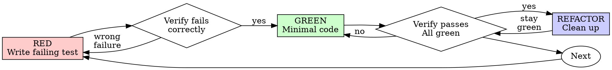

## 11 test-driven-development

> 译自 `reference/superpowers/skills/test-driven-development/SKILL.md`（原文 330 行）。frontmatter、全部围栏代码块（dot 图、TypeScript 测试代码、bash 命令）与 `<Good>` / `<Bad>` 标签按原样保留。
> 对照 `READING-superpowers.md` 第 12 项。

**frontmatter**

- `name`: `test-driven-development`
- `description`: `Use when implementing any feature or bugfix, before writing implementation code`

### 11.1 概览（Overview）

先写测试。看它失败。写最少的代码让它通过。

**核心原则：** 如果你没有亲眼看着测试失败，你就不知道它测的是不是对的东西。

**违反规则的字面，就是违反规则的精神。**

### 11.2 何时使用（When to Use）

**永远：**
- 新功能
- Bug 修复
- 重构
- 行为变更

**例外（问你的人类搭档）：**
- 一次性原型
- 生成的代码
- 配置文件

在想「就这一次，跳过 TDD」？停。那是合理化。

### 11.3 铁律（The Iron Law）

```
NO PRODUCTION CODE WITHOUT A FAILING TEST FIRST
```

先写了代码才写测试？删掉它。从头再来。

**没有例外：**
- 不要把它留作「参考」
- 不要在写测试时「改造」它
- 不要看它
- 删就是删

从测试出发，全新实现。就这样。

### 11.4 红-绿-重构（Red-Green-Refactor）



#### 11.4.1 RED - 写一个失败的测试（RED - Write Failing Test）

写一个最小的测试，展示应该发生什么。

<Good>
```typescript
test('retries failed operations 3 times', async () => {
  let attempts = 0;
  const operation = () => {
    attempts++;
    if (attempts < 3) throw new Error('fail');
    return 'success';
  };

  const result = await retryOperation(operation);

  expect(result).toBe('success');
  expect(attempts).toBe(3);
});
```
名字清晰，测真实行为，只测一件事
</Good>

<Bad>
```typescript
test('retry works', async () => {
  const mock = jest.fn()
    .mockRejectedValueOnce(new Error())
    .mockRejectedValueOnce(new Error())
    .mockResolvedValueOnce('success');
  await retryOperation(mock);
  expect(mock).toHaveBeenCalledTimes(3);
});
```
名字含糊，测的是 mock 而不是代码
</Bad>

**要求：**
- 一个行为
- 名字清晰
- 真实代码（除非无法避免，否则不用 mock）

#### 11.4.2 验证 RED - 看着它失败（Verify RED - Watch It Fail）

**强制。绝不跳过。**

```bash
npm test path/to/test.test.ts
```

确认：
- 测试失败（不是报错）
- 失败信息符合预期
- 失败的原因是功能缺失（不是拼写错误）

**测试通过了？** 你在测已有的行为。修测试。

**测试报错了？** 修错误，重跑，直到它正确失败。

#### 11.4.3 GREEN - 最少的代码（GREEN - Minimal Code）

写最简单的代码让测试通过。

<Good>
```typescript
async function retryOperation<T>(fn: () => Promise<T>): Promise<T> {
  for (let i = 0; i < 3; i++) {
    try {
      return await fn();
    } catch (e) {
      if (i === 2) throw e;
    }
  }
  throw new Error('unreachable');
}
```
刚好够通过
</Good>

<Bad>
```typescript
async function retryOperation<T>(
  fn: () => Promise<T>,
  options?: {
    maxRetries?: number;
    backoff?: 'linear' | 'exponential';
    onRetry?: (attempt: number) => void;
  }
): Promise<T> {
  // YAGNI
}
```
过度设计
</Bad>

不要加功能、不要重构别的代码、不要做超出这个测试的「改进」。

#### 11.4.4 验证 GREEN - 看着它通过（Verify GREEN - Watch It Pass）

**强制。**

```bash
npm test path/to/test.test.ts
```

确认：
- 测试通过
- 其他测试仍然通过
- 输出干净（没有错误、警告）

**测试失败？** 修代码，不是修测试。

**其他测试失败？** 现在就修。

**「其他测试」指的是项目的测试套件，不只是你那个文件。** 你写的那个测试跑绿了不等于整套套件是绿的。在你宣布改动完成之前，跑一遍项目的测试命令（裸 `pytest`、`npm test`、`cargo test`——仓库用哪个就用哪个），哪怕你的任务只点名了一个测试文件。任务里的范围说明限定的是交付物，不是你的验证范围。那次运行暴露的任何失败——包括不是你造成的——都要在报告里点名写出；一个你眼看着滚过去却没提的红测试，是一份因省略而造假的报告。

#### 11.4.5 REFACTOR - 清理（REFACTOR - Clean Up）

只在绿了之后：
- 去掉重复
- 改进命名
- 抽取辅助函数

保持测试绿。不要加行为。

#### 11.4.6 重复（Repeat）

为下一个功能写下下一个失败的测试。

### 11.5 好测试（Good Tests）

| 品质 | 好 | 坏 |
|---------|------|-----|
| **最小** | 一件事。名字里有「and」？拆开它。 | `test('validates email and domain and whitespace')` |
| **清晰** | 名字描述行为 | `test('test1')` |
| **展现意图** | 展示期望的 API | 让代码该做什么变得晦涩 |

在写或改任何测试时，读 [writing-good-tests.md](writing-good-tests.md)，了解让测试保持诚实的规则：
- 在写测试之前，先点名哪个生产代码改动会让这个测试失败
- 对真实行为断言，绝不对 mock 的行为断言
- 只用于测试的代码放在测试工具里，不要放进生产类
- 在 mock 一个依赖之前，先理解它的副作用

### 11.6 常见合理化（Common Rationalizations）

| 借口 | 真相 |
|--------|---------|
| “太简单了，不用测” | 简单的代码也会坏。写个测试只要 30 秒。 |
| “我之后再测” | 事后写的测试会立刻通过——而这什么都证明不了。它们可能测错了东西、测的是实现而不是行为，或者漏掉你忘了的边界情况。你从没看着它失败，所以你也从没证明它能抓住这个 bug。测试先行强制出那次失败。 |
| “事后测试达到同样目标（精神而非仪式）” | 事后测试回答「这个做了什么？」；测试先行回答「这个应该做什么？」。事后写的测试被你已经写好的代码带偏——你验证的是你记得的那些情况，而不是你本来会发现的情况。这是有覆盖率、但没有测试有效的证明。 |
| “我已经手工测过了” | 手工测试是随机的：没有记录你覆盖了什么，代码一变就无法重跑，压力下容易漏掉情况。「我试的时候是好的」≠ 全面。自动化测试每次都以同样的方式运行。 |
| “删掉 X 小时的工作太浪费” | 沉没成本谬误——那段时间无论如何都已经花掉了。真正的选择是：用 TDD 重写（高置信度）vs. 留着它、事后再钉上测试（低置信度，很可能有 bug）。留着你信不过的代码才是浪费。 |
| “留作参考，先写测试” | 你会改造它。那就是事后测试。删就是删。 |
| “我需要先探索一下” | 可以。扔掉探索的产物，从 TDD 开始。 |
| “测试难 = 设计不清楚” | 听测试的。难测 = 难用。 |
| “TDD 会拖慢我” | TDD 才是务实之路：在提交前抓住 bug、防止回归、让你敢重构。「务实」的捷径意味着在生产环境里调试——更慢，不是更快。 |
| “手工测更快” | 手工测不能证明边界情况。每次改动你都得重测一遍。 |
| “现有代码没有测试” | 你正在改进它。为现有代码补测试。 |

### 11.7 红旗 - 停下并从头再来（Red Flags - STOP and Start Over）

- 测试之前先有代码
- 实现之后才写测试
- 测试立刻通过
- 说不清测试为什么失败
- 「之后」再补的测试
- 把「就这一次」合理化
- “我已经手工测过了”
- “事后测试达到同样的目的”
- “关键是精神不是仪式”
- “留作参考”或者“改造现有代码”
- “已经花了 X 小时，删掉太浪费”
- “TDD 是教条，我在务实”
- “这次不一样，因为……”

**所有这些都意味着：删掉代码。用 TDD 从头再来。**

### 11.8 示例：Bug 修复（Example: Bug Fix）

**Bug：** 空 email 被接受

**RED**
```typescript
test('rejects empty email', async () => {
  const result = await submitForm({ email: '' });
  expect(result.error).toBe('Email required');
});
```

**验证 RED**
```bash
$ npm test
FAIL: expected 'Email required', got undefined
```

**GREEN**
```typescript
function submitForm(data: FormData) {
  if (!data.email?.trim()) {
    return { error: 'Email required' };
  }
  // ...
}
```

**验证 GREEN**
```bash
$ npm test
PASS
```

**REFACTOR**
有需要时为多个字段抽取校验。

### 11.9 验证清单（Verification Checklist）

在把工作标记为完成之前：

- [ ] 每个新函数/方法都有测试
- [ ] 每个测试在实现之前都被看着失败过
- [ ] 每个测试都因预期原因失败（功能缺失，不是拼写错误）
- [ ] 写了最少的代码让每个测试通过
- [ ] 所有测试都通过
- [ ] 输出干净（没有错误、警告）
- [ ] 测试使用真实代码（除非无法避免才用 mock）
- [ ] 边界情况和错误都被覆盖

没办法勾满所有框？你跳过了 TDD。从头再来。

### 11.10 卡住时（When Stuck）

| 问题 | 解法 |
|---------|----------|
| 不知道怎么测 | 写出你期望的 API。先写断言。问你的人类搭档。 |
| 测试太复杂 | 设计太复杂。简化接口。 |
| 什么都要 mock | 代码耦合太重。用依赖注入。 |
| 测试的准备代码巨大 | 抽取辅助函数。还是复杂？简化设计。 |

### 11.11 调试集成（Debugging Integration）

发现 bug 了？写一个复现它的失败测试。走 TDD 循环。测试既证明修复，也防止回归。

绝不在没有测试的情况下修 bug。

### 11.12 最终规则（Final Rule）

```
Production code → test exists and failed first
Otherwise → not TDD
```

没有你的人类搭档的许可，没有例外。
