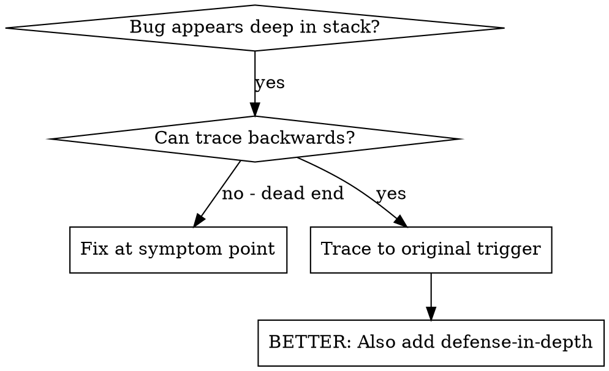
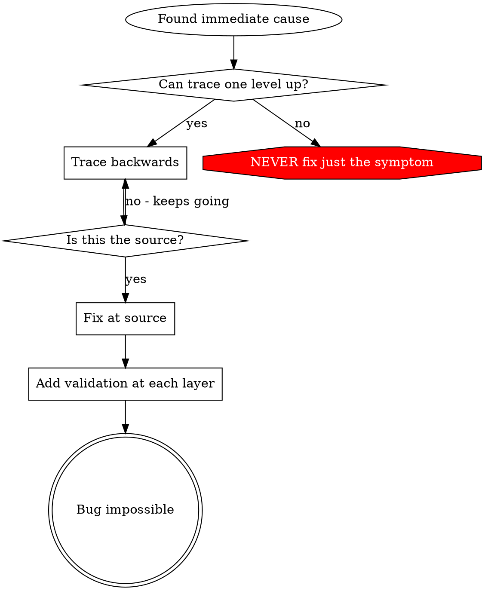

## 18 root-cause-tracing
> 译自 `reference/superpowers/skills/systematic-debugging/root-cause-tracing.md`（原文 169 行）。原文无 YAML frontmatter；全部九个代码块（两张 dot 图、四段 TypeScript、两段 bash、一段未标语言的报错输出）按原样保留。
> 对照 `READING-superpowers.md` 第 19 项。

**根本原因追溯（Root Cause Tracing）**

### 18.1 概览（Overview）

缺陷常常在调用栈深处才显现（git init 跑在了错误的目录、文件被创建到错误的位置、数据库以错误的路径被打开）。你的本能是在错误出现的地方动手修，但那是在治标。

**核心原则：** 沿调用链向后追溯，直到找到最初的触发点，然后从源头修复。

### 18.2 何时使用（When to Use）



**在以下情况使用：**
- 错误发生在执行深处（而不是在入口点）
- 堆栈跟踪显示出一条很长的调用链
- 不清楚非法数据源自哪里
- 需要找出是哪个测试／哪段代码触发了这个问题

### 18.3 追溯流程（The Tracing Process）

#### 18.3.1 观察症状（1. Observe the Symptom）
```
Error: git init failed in ~/project/packages/core
```

#### 18.3.2 找到直接原因（2. Find Immediate Cause）
**哪段代码直接导致了它？**
```typescript
await execFileAsync('git', ['init'], { cwd: projectDir });
```

#### 18.3.3 追问：是谁调用了它？（3. Ask: What Called This?）
```typescript
WorktreeManager.createSessionWorktree(projectDir, sessionId)
  → called by Session.initializeWorkspace()
  → called by Session.create()
  → called by test at Project.create()
```

#### 18.3.4 继续向上追溯（4. Keep Tracing Up）
**传进来的是什么值？**
- `projectDir = ''`（空字符串！）
- 空字符串作为 `cwd` 会解析到 `process.cwd()`
- 那正是源码目录！

#### 18.3.5 找到最初的触发点（5. Find Original Trigger）
**空字符串是从哪儿来的？**
```typescript
const context = setupCoreTest(); // Returns { tempDir: '' }
Project.create('name', context.tempDir); // Accessed before beforeEach!
```

### 18.4 添加堆栈跟踪（Adding Stack Traces）

手工追溯不了时，就加插桩：

```typescript
// Before the problematic operation
async function gitInit(directory: string) {
  const stack = new Error().stack;
  console.error('DEBUG git init:', {
    directory,
    cwd: process.cwd(),
    nodeEnv: process.env.NODE_ENV,
    stack,
  });

  await execFileAsync('git', ['init'], { cwd: directory });
}
```

**关键：** 在测试里用 `console.error()`（不要用 logger——它可能不显示）

**运行并抓取：**
```bash
npm test 2>&1 | grep 'DEBUG git init'
```

**分析堆栈跟踪：**
- 找测试文件名
- 找到触发这次调用的行号
- 识别其中的模式（同一个测试？同一个参数？）

### 18.5 找出是哪个测试造成了污染（Finding Which Test Causes Pollution）

如果测试期间出现了某种东西，但你不知道是哪个测试造成的：

用本目录下的二分脚本 `find-polluter.sh`：

```bash
bash ./find-polluter.sh '.git' 'src/**/*.test.ts'
```

逐个跑测试，在第一个污染者处停下。用法见该脚本。

### 18.6 真实案例：空的 projectDir（Real Example: Empty projectDir）

**症状：** `.git` 被创建在 `packages/core/`（源码目录）里

**追溯链：**
1. `git init` 跑在 `process.cwd()` 里 ← cwd 参数为空
2. WorktreeManager 被以空的 projectDir 调用
3. Session.create() 传入了空字符串
4. 测试在 beforeEach 之前访问了 `context.tempDir`
5. setupCoreTest() 初始返回 `{ tempDir: '' }`

**根本原因：** 顶层变量初始化时访问到了空值

**修复：** 把 tempDir 做成 getter，在 beforeEach 之前访问就抛错

**还加了纵深防御：**
- 第 1 层：Project.create() 校验目录
- 第 2 层：WorkspaceManager 校验非空
- 第 3 层：NODE_ENV 护栏拒绝在 tmpdir 之外执行 git init
- 第 4 层：git init 之前记录堆栈跟踪

### 18.7 关键原则（Key Principle）



**绝不要只在错误出现的地方修。** 向后追溯，找到最初的触发点。

### 18.8 堆栈跟踪要点（Stack Trace Tips）

**在测试里：** 用 `console.error()` 而不是 logger——logger 可能被抑制
**操作之前：** 在危险操作之前记录日志，而不是等它失败之后再记
**包含上下文：** 目录、cwd、环境变量、时间戳
**抓取堆栈：** `new Error().stack` 显示完整的调用链

### 18.9 真实世界的影响（Real-World Impact）

来自一次调试会话（2025-10-03）：
- 通过 5 层追溯找到了根本原因
- 从源头修复（getter 校验）
- 加了 4 层防御
- 1847 个测试通过，零污染
