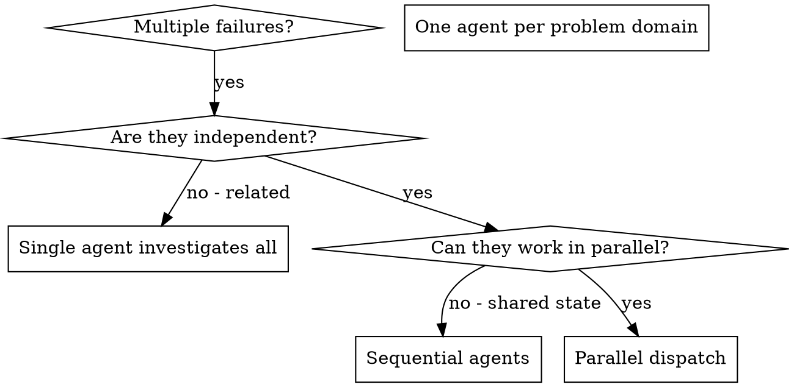

## 22 dispatching-parallel-agents
> 译自 `reference/superpowers/skills/dispatching-parallel-agents/SKILL.md`（原文 167 行）。frontmatter 与全部代码块（一张 dot 图、`Subagent` 派发示例、`markdown` 提示词示例、`Agent 1 →` 派发示例）按原样保留。
> 对照 `READING-superpowers.md` 第 23 项。

**frontmatter**

- `name`: `dispatching-parallel-agents`
- `description`: `Use when facing 2+ independent tasks that can be worked on without shared state or sequential dependencies`

**派发并行智能体（Dispatching Parallel Agents）**

### 22.1 概览（Overview）

你把任务委派给上下文隔离的专用 agent。通过精确构筑它们的指令与上下文，你保证它们保持专注、完成任务。它们**绝不继承你会话的上下文或历史**——你亲手构造它们正好需要的东西。这同时保住了你自己的上下文，用来做协调工作。

当你手上有多个互不相关的失败（不同的测试文件、不同的子系统、不同的 bug）时，逐个串行调查是浪费时间。每次调查都是独立的，可以并行发生。

**核心原则：** 每个独立问题域派一个 agent。让它们并发工作。

### 22.2 何时使用（When to Use）



**适用情形：**
- 3 个以上测试文件以不同根因失败
- 多个子系统各自独立地坏掉
- 每个问题都能在不借助其他问题的上下文的情况下被理解
- 各次调查之间没有共享状态

**不适用情形：**
- 失败彼此相关（修好一个可能顺带修好别的）
- 需要理解整个系统的状态
- agent 之间会互相干扰

### 22.3 模式（The Pattern）

#### 22.3.1 识别相互独立的领域（1. Identify Independent Domains）

按「坏的是什么」给失败分组：
- 文件 A 的测试：工具审批流程
- 文件 B 的测试：批处理完成行为
- 文件 C 的测试：中止功能

每个领域都是独立的——修工具审批不影响中止相关的测试。

#### 22.3.2 创建聚焦的 Agent 任务（2. Create Focused Agent Tasks）

每个 agent 拿到：
- **明确的范围：** 一个测试文件或子系统
- **清晰的目标：** 让这些测试通过
- **约束：** 不要改动其他代码
- **预期产出：** 你发现了什么、修了什么的总结

#### 22.3.3 并行派发（3. Dispatch in Parallel）

在同一个回复里发出全部三个子智能体派发——它们会并行运行：

```text
Subagent (general-purpose): "Fix agent-tool-abort.test.ts failures"
Subagent (general-purpose): "Fix batch-completion-behavior.test.ts failures"
Subagent (general-purpose): "Fix tool-approval-race-conditions.test.ts failures"
# All three run concurrently.
```

一个回复里多次派发调用 = 并行执行。一个回复一次 = 串行。

#### 22.3.4 评审与集成（4. Review and Integrate）

当 agent 返回时：
- 读每一份总结
- 核实各修复之间不冲突
- 跑完整测试套件
- 集成所有改动

### 22.4 Agent 提示词结构（Agent Prompt Structure）

好的 agent 提示词是：
1. **聚焦**——一个清晰的问题域
2. **自包含**——理解该问题所需的全部上下文
3. **对产出有明确要求**——agent 应该返回什么？

```markdown
Fix the 3 failing tests in src/agents/agent-tool-abort.test.ts:

1. "should abort tool with partial output capture" - expects 'interrupted at' in message
2. "should handle mixed completed and aborted tools" - fast tool aborted instead of completed
3. "should properly track pendingToolCount" - expects 3 results but gets 0

These are timing/race condition issues. Your task:

1. Read the test file and understand what each test verifies
2. Identify root cause - timing issues or actual bugs?
3. Fix by:
   - Replacing arbitrary timeouts with event-based waiting
   - Fixing bugs in abort implementation if found
   - Adjusting test expectations if testing changed behavior

Do NOT just increase timeouts - find the real issue.

Return: Summary of what you found and what you fixed.
```

### 22.5 常见错误（Common Mistakes）

**❌ 太宽泛：**“把所有测试都修好”——agent 会迷失
**✅ 具体：**“修 agent-tool-abort.test.ts”——范围聚焦

**❌ 没有上下文：**“修一下这个竞态条件”——agent 不知道在哪儿
**✅ 有上下文：**把错误信息和测试名粘进去

**❌ 没有约束：**agent 可能把所有东西都重构一遍
**✅ 有约束：**“不要改动生产代码”或“只修测试”

**❌ 产出含糊：**“修好它”——你不知道改了什么
**✅ 明确：**“返回根因与改动的总结”

### 22.6 何时不要使用（When NOT to Use）

**相关的失败：**修好一个可能顺带修好别的——先一起调查
**需要完整上下文：**要理解就得看到整个系统
**探索性调试：**你还不知道哪里坏了
**共享状态：**agent 之间会互相干扰（编辑同样的文件、使用同样的资源）

### 22.7 会话中的真实例子（Real Example from Session）

**场景：**一次大规模重构之后，3 个文件里共 6 个测试失败

**失败：**
- agent-tool-abort.test.ts：3 个失败（时序问题）
- batch-completion-behavior.test.ts：2 个失败（工具没有执行）
- tool-approval-race-conditions.test.ts：1 个失败（执行次数 = 0）

**判断：**这些是相互独立的领域——中止逻辑、批处理完成、竞态条件三者彼此分离

**派发：**
```
Agent 1 → Fix agent-tool-abort.test.ts
Agent 2 → Fix batch-completion-behavior.test.ts
Agent 3 → Fix tool-approval-race-conditions.test.ts
```

**结果：**
- Agent 1：把超时替换成基于事件的等待
- Agent 2：修掉事件结构 bug（threadId 放错了位置）
- Agent 3：增加对异步工具执行完成的等待

**集成：**所有修复彼此独立、没有冲突，完整套件全绿

### 22.8 验证（Verification）

当 agent 返回之后：
1. **评审每份总结**——理解改了什么
2. **检查冲突**——agent 是否编辑了同一段代码？
3. **跑完整套件**——核实所有修复能一起工作
4. **抽查**——agent 可能犯系统性错误
