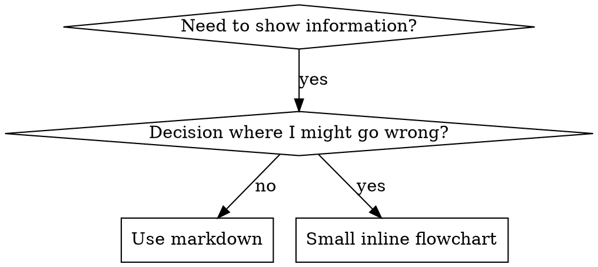

## 23 writing-skills

> 译自 `reference/superpowers/skills/writing-skills/SKILL.md`（原文 681 行）。frontmatter 与全部二十一个代码块（YAML 示例、dot 图、bash 命令、markdown 示例）按原样保留。
> 对照 `READING-superpowers.md` 第 24 项。

**frontmatter**

- `name`: `writing-skills`
- `description`: `Use when creating new skills, editing existing skills, or verifying skills work before deployment`

**编写技能（Writing Skills）**

### 23.1 概览（Overview）

**写技能就是「把测试驱动开发应用到流程文档上」。**

**个人技能放在你的运行时 skills 目录里**（Claude Code 上是 `~/.claude/skills/`）——那些运行时的路径见 [codex-tools.md](../using-superpowers/references/codex-tools.md) 或 [gemini-tools.md](../using-superpowers/references/gemini-tools.md)。Codex、Copilot CLI 和 Gemini CLI 也都认得 `~/.agents/skills/`，把它当作跨运行时的别名。

你写测试用例（带子智能体的压力场景），看它们失败（基线行为），写技能（文档），看测试通过（智能体照做），然后重构（堵住后门）。

**核心原则：** 如果你没有在「没有这个技能」的情况下亲眼看到智能体失败，你就不知道这个技能教的是不是对的东西。

**必需背景：** 使用本技能之前，你必须理解 superpowers:test-driven-development。那个技能定义了根本的 RED-GREEN-REFACTOR 循环。本技能把 TDD 适配到文档上。

**官方指南：** Anthropic 官方的技能编写最佳实践见 anthropic-best-practices.md。那份文档提供了额外的模式和准则，与本技能以 TDD 为中心的做法互补。

### 23.2 什么是技能？（What is a Skill?）

**技能（skill）** 是经过验证的技术、模式或工具的参考指南。技能帮未来的智能体找到并应用有效的做法。

**技能是：** 可复用的技术、模式、工具、参考指南

**技能不是：** 关于你某次如何解决某个问题的叙事

### 23.3 技能的 TDD 对照表（TDD Mapping for Skills）

| TDD 概念 | 技能创建 |
|-------------|----------------|
| **测试用例** | 带子智能体的压力场景 |
| **生产代码** | 技能文档（SKILL.md） |
| **测试失败（RED）** | 没有技能时智能体违反规则（基线） |
| **测试通过（GREEN）** | 技能在场时智能体照做 |
| **重构** | 在保持依从的前提下堵住后门 |
| **先写测试** | 写技能之前先跑基线场景 |
| **看它失败** | 把智能体用的借口逐字记录下来 |
| **最少代码** | 写技能时针对那些具体的违规 |
| **看它通过** | 验证智能体现在照做了 |
| **重构循环** | 找出新借口 → 堵住 → 再验证 |

整个技能创建过程都遵循 RED-GREEN-REFACTOR。

### 23.4 何时创建一个技能（When to Create a Skill）

**在这些情况下创建：**
- 这门技术对你来说不是直觉上显而易见的
- 你会跨项目再次参考它
- 模式适用范围广（不是项目专属）
- 别人也会受益

**不要为这些创建：**
- 一次性的解法
- 别处已有充分文档的标准做法
- 项目专属约定（放进你的指令文件）
- 机械性约束（如果能用正则/校验强制执行，就自动化它——文档留给需要判断的地方）

### 23.5 技能类型（Skill Types）

#### 23.5.1 技术（Technique）

有步骤可循的具体方法（condition-based-waiting、root-cause-tracing）

#### 23.5.2 模式（Pattern）

思考问题的方式（flatten-with-flags、test-invariants）

#### 23.5.3 参考（Reference）

API 文档、语法指南、工具文档（office docs）

### 23.6 目录结构（Directory Structure）


```
skills/
  skill-name/
    SKILL.md              # Main reference (required)
    supporting-file.*     # Only if needed
```

**扁平命名空间**——所有技能在一个可检索的命名空间里

**以下内容单独成文件：**
1. **重量级参考**（100 行以上）——API 文档、完整语法
2. **可复用工具**——脚本、实用程序、模板

**以下内容保持内联：**
- 原则和概念
- 代码模式（少于 50 行）
- 其他一切

### 23.7 SKILL.md 的结构（SKILL.md Structure）

**frontmatter（YAML）：**
- 两个必填字段：`name` 和 `description`（所有支持的字段见 [agentskills.io/specification](https://agentskills.io/specification)）
- 总长最多 1024 个字符
- `name`：只用字母、数字和连字符（不要括号、特殊字符）
- `description`：第三人称，只描述何时使用（不是它做什么）
  - 以 "Use when..." 开头，把重点放在触发条件上
  - 包含具体的症状、情境和上下文
  - **绝不概括技能的流程或工作流**（原因见 SDO 一节）
  - 如果可能，控制在 500 个字符以内

```markdown
---
name: Skill-Name-With-Hyphens
description: Use when [specific triggering conditions and symptoms]
---

# Skill Name

## Overview
What is this? Core principle in 1-2 sentences.

## When to Use
[Small inline flowchart IF decision non-obvious]

Bullet list with SYMPTOMS and use cases
When NOT to use

## Core Pattern (for techniques/patterns)
Before/after code comparison

## Quick Reference
Table or bullets for scanning common operations

## Implementation
Inline code for simple patterns
Link to file for heavy reference or reusable tools

## Common Mistakes
What goes wrong + fixes

## Real-World Impact (optional)
Concrete results
```


### 23.8 技能发现优化（Skill Discovery Optimization (SDO)）

**对发现至关紧要：** 未来的智能体需要**找到**你的技能

#### 23.8.1 丰富的 description 字段（1. Rich Description Field）

**目的：** 你的智能体读 description 来决定某个任务该加载哪些技能。让它回答：「我现在该读这个技能吗？」

**格式：** 以 "Use when..." 开头，把重点放在触发条件上

**关键：description = 何时使用，而不是技能做什么**

description 只应描述触发条件。不要在 description 里概括技能的流程或工作流。

**为什么这重要：** 测试发现，当 description 概括了技能的工作流时，智能体会照 description 做，而不去读完整的技能内容。一句写着 "code review between tasks" 的 description 让一个智能体只做了一次评审，尽管技能的流程图清楚画着两次评审（先 spec 合规，再代码质量）。

当 description 改成只有 "Use when executing implementation plans with independent tasks"（不含工作流概括）时，那个智能体正确地读了流程图，并遵循了两阶段评审流程。

**陷阱：** 概括工作流的 description 造出一条智能体会走的捷径。技能正文变成了智能体跳过的文档。

```yaml
# ❌ BAD: Summarizes workflow - agents may follow this instead of reading skill
description: Use when executing plans - dispatches subagent per task with code review between tasks

# ❌ BAD: Too much process detail
description: Use for TDD - write test first, watch it fail, write minimal code, refactor

# ✅ GOOD: Just triggering conditions, no workflow summary
description: Use when executing implementation plans with independent tasks in the current session

# ✅ GOOD: Triggering conditions only
description: Use when implementing any feature or bugfix, before writing implementation code
```

**内容：**
- 用具体的触发条件、症状和情境，让人知道这个技能适用
- 描述**问题**（竞态条件、行为不一致），而不是**语言特有的症状**（setTimeout、sleep）
- 触发条件保持技术无关，除非技能本身就是技术专用的
- 如果技能是技术专用的，在触发条件里把这一点写明确
- 用第三人称写（会被注入 system prompt）
- **绝不概括技能的流程或工作流**

```yaml
# ❌ BAD: Too abstract, vague, doesn't include when to use
description: For async testing

# ❌ BAD: First person
description: I can help you with async tests when they're flaky

# ❌ BAD: Mentions technology but skill isn't specific to it
description: Use when tests use setTimeout/sleep and are flaky

# ✅ GOOD: Starts with "Use when", describes problem, no workflow
description: Use when tests have race conditions, timing dependencies, or pass/fail inconsistently

# ✅ GOOD: Technology-specific skill with explicit trigger
description: Use when using React Router and handling authentication redirects
```

#### 23.8.2 关键词覆盖（2. Keyword Coverage）

用智能体会去搜的词：
- 错误消息："Hook timed out"、"ENOTEMPTY"、"race condition"
- 症状："flaky"、"hanging"、"zombie"、"pollution"
- 同义词："timeout/hang/freeze"、"cleanup/teardown/afterEach"
- 工具：实际命令、库名、文件类型

#### 23.8.3 描述性命名（3. Descriptive Naming）

**用主动语态，动词开头：**
- ✅ `creating-skills`，不是 `skill-creation`
- ✅ `condition-based-waiting`，不是 `async-test-helpers`

#### 23.8.4 token 效率（关键）（4. Token Efficiency (Critical)）

**问题：** 入门类和被频繁引用的技能会加载进**每一次**对话。每一个 token 都算数。

**目标词数：**
- 入门工作流：每个少于 150 词
- 频繁加载的技能：合计少于 200 词
- 其他技能：少于 500 词（仍要简洁）

**技巧：**

**把细节挪到工具帮助里：**
```bash
# ❌ BAD: Document all flags in SKILL.md
search-conversations supports --text, --both, --after DATE, --before DATE, --limit N

# ✅ GOOD: Reference --help
search-conversations supports multiple modes and filters. Run --help for details.
```

**使用交叉引用：**
```markdown
# ❌ BAD: Repeat workflow details
When searching, dispatch subagent with template...
[20 lines of repeated instructions]

# ✅ GOOD: Reference other skill
Always use subagents (50-100x context savings). REQUIRED: Use [other-skill-name] for workflow.
```

**压缩示例：**
```markdown
# ❌ BAD: Verbose example (42 words)
your human partner: "How did we handle authentication errors in React Router before?"
You: I'll search past conversations for React Router authentication patterns.
[Dispatch subagent with search query: "React Router authentication error handling 401"]

# ✅ GOOD: Minimal example (20 words)
Partner: "How did we handle auth errors in React Router?"
You: Searching...
[Dispatch subagent → synthesis]
```

**消除冗余：**
- 不要重复交叉引用技能里已有的东西
- 不要解释从命令就能看出来的东西
- 不要为同一个模式放多个示例

**验证：**
```bash
wc -w skills/path/SKILL.md
# getting-started workflows: aim for <150 each
# Other frequently-loaded: aim for <200 total
```

**按你做的事或核心洞见命名：**
- ✅ `condition-based-waiting` 好于 `async-test-helpers`
- ✅ `using-skills`，不是 `skill-usage`
- ✅ `flatten-with-flags` 好于 `data-structure-refactoring`
- ✅ `root-cause-tracing` 好于 `debugging-techniques`

**动名词（-ing）很适合流程：**
- `creating-skills`、`testing-skills`、`debugging-with-logs`
- 主动，描述你正在做的动作

#### 23.8.5 交叉引用其他技能（5. Cross-Referencing Other Skills）

**在写引用其他技能的文档时：**

只写技能名，配明确的必需性标记：
- ✅ 好：`**REQUIRED SUB-SKILL:** Use superpowers:test-driven-development`
- ✅ 好：`**REQUIRED BACKGROUND:** You MUST understand superpowers:systematic-debugging`
- ❌ 坏：`See skills/testing/test-driven-development`（看不出是不是必需）
- ❌ 坏：`@skills/testing/test-driven-development/SKILL.md`（强制加载，烧上下文）

**为什么不用 @ 链接：** `@` 语法会立刻强制加载文件，在你需要它们之前就消耗掉 20 万以上的上下文。

### 23.9 流程图的用法（Flowchart Usage）



**只在这些情况下用流程图：**
- 不明显的决策点
- 你可能过早停下的流程循环
- 「什么时候用 A 还是 B」类的决策

**绝不要为这些用流程图：**
- 参考资料 → 表格、清单
- 代码示例 → Markdown 代码块
- 线性指令 → 编号清单
- 没有语义的标签（step1、helper2）

graphviz 的风格规则见本目录下的 `graphviz-conventions.dot`。

**为你的人类搭档做可视化：** 用本目录下的 `render-graphs.js` 把某个技能的流程图渲染成 SVG：
```bash
node ./render-graphs.js ../some-skill           # Each diagram separately
node ./render-graphs.js ../some-skill --combine # All diagrams in one SVG
```

### 23.10 代码示例（Code Examples）

**一个出色的示例胜过许多平庸的示例**

选最相关的语言：
- 测试技术 → TypeScript/JavaScript
- 系统调试 → Shell/Python
- 数据处理 → Python

**好示例：**
- 完整、可运行
- 注释到位，解释**为什么**
- 来自真实场景
- 清楚展示模式
- 拿来就能改（不是通用模板）

**不要：**
- 用 5 种以上语言实现
- 造填空式模板
- 写生编的示例

你很擅长移植——一个出色的示例就够了。

### 23.11 文件组织（File Organization）

#### 23.11.1 自足型技能（Self-Contained Skill）
```
defense-in-depth/
  SKILL.md    # Everything inline
```
何时：所有内容都放得下，不需要重量级参考

#### 23.11.2 带可复用工具的技能（Skill with Reusable Tool）
```
condition-based-waiting/
  SKILL.md    # Overview + patterns
  example.ts  # Working helpers to adapt
```
何时：工具是可复用代码，不只是叙述

#### 23.11.3 带重量级参考的技能（Skill with Heavy Reference）
```
pptx/
  SKILL.md       # Overview + workflows
  pptxgenjs.md   # 600 lines API reference
  ooxml.md       # 500 lines XML structure
  scripts/       # Executable tools
```
何时：参考资料太大，无法内联

在正文里通过解释器调用随包脚本（`bash scripts/tool.sh`、`node scripts/tool.js`），绝不要只写裸路径：有些 harness 插件打包器会剥掉可执行位，那里一个裸的 `scripts/tool.sh` 会因为 `Permission denied` 而失败。

### 23.12 铁律（与 TDD 相同）（The Iron Law (Same as TDD)）

```
NO SKILL WITHOUT A FAILING TEST FIRST
```

这既适用于**新**技能，也适用于对既有技能的**修改**。

先写技能再测试？删掉它。从头开始。
改技能而不测试？同样的违规。

**没有例外：**
- 不因为「简单的补充」
- 不因为「只是加一节」
- 不因为「文档更新」
- 不要把没测过的改动留作「参考」
- 不要在跑测试的同时「改编」
- 删除就是删除

**必需背景：** superpowers:test-driven-development 技能解释了为什么这重要。同样的原则适用于文档。

### 23.13 测试所有技能类型（Testing All Skill Types）

不同的技能类型需要不同的测试方法：

#### 23.13.1 纪律约束型技能（规则/要求）（Discipline-Enforcing Skills (rules/requirements)）

**例子：** TDD、verification-before-completion、designing-before-coding

**用这些来测：**
- 学术式提问：它们理解规则吗？
- 压力场景：它们在压力下照做吗？
- 多种压力叠加：时间 + 沉没成本 + 精疲力尽
- 找出借口，加上明确的回击

**成功标准：** 智能体在最大压力下仍遵守规则

#### 23.13.2 技术型技能（操作指南）（Technique Skills (how-to guides)）

**例子：** condition-based-waiting、root-cause-tracing、defensive-programming

**用这些来测：**
- 应用场景：它们能正确应用这门技术吗？
- 变体场景：它们能处理边界情况吗？
- 信息缺失测试：指令有缺口吗？

**成功标准：** 智能体成功把技术应用到一个新场景

#### 23.13.3 模式型技能（心智模型）（Pattern Skills (mental models)）

**例子：** reducing-complexity、information-hiding 概念

**用这些来测：**
- 识别场景：它们能认出模式何时适用吗？
- 应用场景：它们能用这个心智模型吗？
- 反例：它们知道何时**不**该应用吗？

**成功标准：** 智能体正确识别出何时/如何应用模式

#### 23.13.4 参考型技能（文档/API）（Reference Skills (documentation/APIs)）

**例子：** API 文档、命令参考、库指南

**用这些来测：**
- 检索场景：它们能找到正确的信息吗？
- 应用场景：它们能正确使用找到的东西吗？
- 缺口测试：常见用例覆盖到了吗？

**成功标准：** 智能体找到并正确应用参考信息

### 23.14 跳过测试的常见合理化（Common Rationalizations for Skipping Testing）

| 借口 | 真相 |
|--------|---------|
| 「技能明显很清楚」 | 对你清楚 ≠ 对其他智能体清楚。去测。 |
| 「这只是参考资料」 | 参考资料也会有缺口、有含混的段落。测检索。 |
| 「测试是大炮打蚊子」 | 没测过的技能一定有问题。一定。15 分钟测试省下几小时。 |
| 「出了问题我再测」 | 出了问题 = 智能体用不了这个技能。部署之前就测。 |
| 「测起来太琐碎」 | 测试比在生产里调试一个坏技能要少琐碎。 |
| 「我有信心它很好」 | 过度自信保证出问题。照样测。 |
| 「学术评审就够了」 | 读过 ≠ 用过。测应用场景。 |
| 「没时间测」 | 部署没测的技能，之后花更多时间修它。 |

**所有这些都意味着：部署之前先测。没有例外。**

### 23.15 让形式匹配失败（Match the Form to the Failure）

在写引导文字之前，先给基线失败分类。能让一类失败变得防弹的形式，用在另一类上会可测量地适得其反。

| 基线失败 | 正确的形式 | 错误的形式 |
|---|---|---|
| 在压力下跳过/违反规则（明知更好，还是做了） | 禁止 + 合理化表 + 红旗清单（见下文「技能防弹化」） | 软性引导（"prefer..."、"consider..."） |
| 照做了，但输出的形状不对（提示词臃肿、结论被埋、spec 被复述） | 正面配方或契约：说明输出**是**什么——它的组成部分，按顺序 | 禁止清单（"don't restate"、"never narrate"） |
| 漏掉一个他本来就会产出的必需元素 | 结构性：在他要填的模板里放一个 REQUIRED 字段或槽位 | 模板旁边的散文式提醒 |
| 行为应当取决于某个条件 | 以可观察的谓词为键的条件句（"if the brief exists, reference it"） | 无条件规则 + 豁免条款 |

**为什么禁止式在「塑形」问题上适得其反：** 在存在竞争性动机（"make the prompt self-contained"）时，智能体会跟 "don't X" 讨价还价。在针对派发提示词引导语的正面对撞措辞测试中，禁止组产出的不想要的内容明显多于配方组（分布完全分离），甚至比无引导的对照组还差——不要凭假设，去微测你自己的场景，但绝不要默认伸手去拿禁止式。配方不留讨价还价的余地：输出要么符合声明的形状，要么不符合。

**无论你选哪种形式，这些规则都适用：**
- **不要细微差别条款。** "Don't X unless it matters" 会重新打开谈判——在同一批措辞测试里，给一条获胜的配方附加一个细微差别条款，就把它从稳定降级成噪声。真正的例外，写成它自己的、以可观察谓词为键的条件句。
- **豁免条款不划定范围。** "This limit doesn't apply to code blocks" 依然会压制代码块。如果输出的一部分必须豁免，就重构结构，让规则够不到它。

### 23.16 让技能对合理化防弹（Bulletproofing Skills Against Rationalization）

强制纪律的技能（比如 TDD）需要能抵御合理化。智能体很聪明，在压力下会找到漏洞。

**适用范围：** 这套工具是给纪律型失败用的——智能体知道规则、却在压力下跳过它。对于形状错误的输出或漏掉的元素，基于禁止的防弹化会适得其反；改用「让形式匹配失败」一节里的形式。

**心理学注记：** 理解说服技巧**为什么**有效，能帮你系统地运用它们。关于权威、承诺、稀缺、社会认同和统一性原则的研究基础（Cialdini, 2021; Meincke et al., 2025），见 persuasion-principles.md。

#### 23.16.1 明确堵住每一个后门（Close Every Loophole Explicitly）

不要只是陈述规则——要禁止具体的绕行办法：

<Bad>
```markdown
Write code before test? Delete it.
```
</Bad>

<Good>
```markdown
Write code before test? Delete it. Start over.

**No exceptions:**
- Don't keep it as "reference"
- Don't "adapt" it while writing tests
- Don't look at it
- Delete means delete
```
</Good>

#### 23.16.2 回应「精神 vs 字面」的论点（Address "Spirit vs Letter" Arguments）

尽早加入根本原则：

```markdown
**Violating the letter of the rules is violating the spirit of the rules.**
```

这切断了「我遵循的是精神」这一整类借口。

#### 23.16.3 建立合理化表（Build Rationalization Table）

把基线测试中的借口记下来（见下文测试一节）。智能体找的每一个借口都进这张表：

```markdown
| Excuse | Reality |
|--------|---------|
| "Too simple to test" | Simple code breaks. Test takes 30 seconds. |
| "I'll test after" | Tests passing immediately prove nothing. |
| "Tests after achieve same goals" | Tests-after = "what does this do?" Tests-first = "what should this do?" |
```

#### 23.16.4 建立红旗清单（Create Red Flags List）

让智能体在找借口时容易自查：

```markdown
## Red Flags - STOP and Start Over

- Code before test
- "I already manually tested it"
- "Tests after achieve the same purpose"
- "It's about spirit not ritual"
- "This is different because..."

**All of these mean: Delete code. Start over with TDD.**
```

#### 23.16.5 为违规症状更新 SDO（Update SDO for Violation Symptoms）

在 description 里加入：你**即将**违反规则时的症状：

```yaml
description: use when implementing any feature or bugfix, before writing implementation code
```

### 23.17 技能的 RED-GREEN-REFACTOR（RED-GREEN-REFACTOR for Skills）

遵循 TDD 循环：

#### 23.17.1 RED：写会失败的测试（基线）（RED: Write Failing Test (Baseline)）

让子智能体在**没有**技能的情况下跑压力场景。把确切行为记录下来：
- 它们做了什么选择？
- 它们用了哪些借口（逐字）？
- 哪些压力触发了违规？

这就是「看测试失败」——写技能之前，你必须看到智能体自然会怎么做。

#### 23.17.2 GREEN：写最小技能（GREEN: Write Minimal Skill）

写一个针对那些具体借口的技能。不要为假设的情况添加额外内容。

在**有**技能的情况下跑同样的场景。智能体现在应该照做了。

#### 23.17.3 REFACTOR：堵住后门（REFACTOR: Close Loopholes）

智能体找到了新借口？加上明确的回击。反复测到防弹为止。

#### 23.17.4 在完整场景之前先微测措辞（Micro-Test Wording Before Full Scenarios）

完整的压力场景运行是最后一道闸门，但每一轮都又慢又贵。先用微测验证措辞本身：

1. **每次调用一个全新上下文的样本**——一次裸 API 调用；没有 API 访问就用一个单次子智能体。system prompt = 这段引导文字将来所处的真实上下文（完整的技能或提示词模板，而不是孤立的那段引导）；user message = 一个会诱使失败的任务。
2. **永远带一个无引导对照组。** 如果对照组没有表现出这个失败，那就没有什么要修的——停下，不要写这段引导。
3. **每个变体重复 5 次以上。** 单次样本会撒谎。
4. **每一条被标记的命中都人工读一遍。** 你愿意的话可以用程序打分，但模板回声和被引用的反例会伪装成命中；只靠自动计数会同时高估失败和成功。
5. **方差是一个指标。** 引导文字起作用时，重复会收敛到同一个形状。五次重复出现五种不同解读，意味着措辞没有约束力——先收紧形式，再考虑加字。

微测验证的是措辞；对纪律型技能，它不能替代压力场景。

**测试方法学：** 完整的测试方法学见 [testing-skills-with-subagents.md](testing-skills-with-subagents.md)：
- 怎么写压力场景
- 压力类型（时间、沉没成本、权威、精疲力尽）
- 系统地堵洞
- 元测试技巧

### 23.18 反模式（Anti-Patterns）

#### 23.18.1 ❌ 叙事式示例（❌ Narrative Example）
「在 2025-10-03 那次会话里，我们发现空的 projectDir 导致了……」
**为什么不好：** 太具体，不可复用

#### 23.18.2 ❌ 多语言稀释（❌ Multi-Language Dilution）
example-js.js、example-py.py、example-go.go
**为什么不好：** 质量平庸，维护负担

#### 23.18.3 ❌ 流程图里的代码（❌ Code in Flowcharts）
```dot
step1 [label="import fs"];
step2 [label="read file"];
```
**为什么不好：** 没法复制粘贴，难读

#### 23.18.4 ❌ 通用标签（❌ Generic Labels）
helper1、helper2、step3、pattern4
**为什么不好：** 标签应该有语义

### 23.19 停止：在进入下一个技能之前（STOP: Before Moving to Next Skill）

**写完任何技能之后，你必须停下来，完成部署流程。**

**不要：**
- 不逐个测试就批量创建多个技能
- 当前这个还没验证就进入下一个技能
- 因为「批量更高效」就跳过测试

**下面这份部署清单对每一个技能都是强制的。**

部署没测过的技能 = 部署没测过的代码。这违反质量标准。

### 23.20 技能创建清单（TDD 改编版）（Skill Creation Checklist (TDD Adapted)）

**重要：为下面每一个清单项建一个 todo。**

**RED 阶段——写会失败的测试：**
- [ ] 创建压力场景（纪律型技能用 3 种以上叠加压力）
- [ ] 在没有技能的情况下跑场景——逐字记录基线行为
- [ ] 找出借口/失败中的模式

**GREEN 阶段——写最小技能：**
- [ ] 名称只用字母、数字、连字符（不要括号/特殊字符）
- [ ] YAML frontmatter 带必填的 `name` 和 `description` 字段（最多 1024 字符；见 [spec](https://agentskills.io/specification)）
- [ ] description 以 "Use when..." 开头，并包含具体的触发条件/症状
- [ ] description 用第三人称写
- [ ] 全篇散布便于检索的关键词（错误、症状、工具）
- [ ] 清晰的概览，带核心原则
- [ ] 针对 RED 阶段找出的具体基线失败
- [ ] 引导形式匹配失败类型（见「让形式匹配失败」）
- [ ] 对塑造行为的引导：措辞已对着无引导对照组做过微测（5 次以上重复，每条被标记的命中都人工读过）——纯参考型技能不适用
- [ ] 代码内联，或链接到单独文件
- [ ] 一个出色的示例（不是多语言）
- [ ] 在有技能的情况下跑场景——验证智能体现在照做了

**REFACTOR 阶段——堵住后门：**
- [ ] 从测试中找出**新**的借口
- [ ] 加上明确的回击（如果是纪律型技能）
- [ ] 用所有测试轮次建立合理化表
- [ ] 建立红旗清单
- [ ] 反复测到防弹为止

**质量检查：**
- [ ] 只有决策不明显时才放小流程图
- [ ] 快速参考表
- [ ] 常见错误一节
- [ ] 不要叙事式讲故事
- [ ] 只有工具或重量级参考才用附属文件

**部署：**
- [ ] 把技能提交到 git 并推送到你的 fork（如果配置了）
- [ ] 考虑通过 PR 回馈上游（如果广泛有用）

### 23.21 发现工作流（Discovery Workflow）

未来的智能体如何找到你的技能：

1. **遇到问题**（"tests are flaky"）
2. **搜索技能**（grep description、浏览分类）
3. **找到 SKILL**（description 匹配）
4. **扫一眼概览**（这相关吗？）
5. **读模式**（快速参考表）
6. **加载示例**（只在实施时）

**针对这条流优化**——把可检索的词放得早、放得多。
