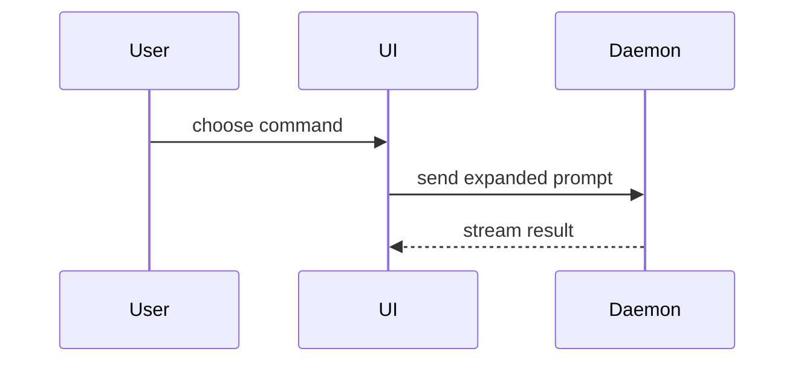

用这个模板写 PR 正文：

```markdown
## Summary

<diagram, diff-sketch, or tree>

## Evidence

- **Before:** <screenshot/output/failing test run>
  **After:** <screenshot/output/passing test run>

## Merge Danger

**Door:** <one-way or two-way>

<optional: description>

**Blast Radius:** <one-word description>

<optional: potential ramifications of merge>
```

## 各节

跳过所有开场白，正文保持简短。使用 `GLOSSARY.md` 里用户的领域语言。

### Summary

挑**能把关键点讲清楚的最小视图**。

- 把逻辑或算法展示为伪代码：

```text
on(save)
  if content is unchanged
    return cached result
  write new content
  return fresh result
```

- 把运行时的控制流展示为调用树：

```text
submitForm
  createSession
    persistPrompt
    launchAgent
  navigateToSession
```

- 把 UI 结构展示为组件树，包含要紧的状态和模块边界：

```text
<SessionPage> (apps/example/src/routes/session.tsx)
  useSessionEvents()
  <SessionToolbar>
    <RunSkillButton> (packages/ui)
```

- 把文件职责或一次大范围重构展示为一棵浅浅的文件树：

```text
src/
├── commands/       # parses user actions
├── sessions/       # owns session state
└── transport/      # sends API requests
```

- 用 Mermaid 展示组件交互、控制流或数据流：



- 当要点是「改了什么」、而周围的形状已经存在时，用 `diff`。让 diff 的形状匹配主题。

  组件改动：

```diff
 <SessionPage>
   useSessionEvents()
   <SessionToolbar>
+    <RunSkillButton />
   <SessionTimeline>
+    <SkillResultCard />
```

  文件布局改动：

```diff
 src/
 ├── commands/
+│   └── show-me.ts       # expands the slash command
 ├── sessions/
-└── transport.ts
+└── transport/
+    ├── client.ts
+    └── stream.ts
```

  调用树或调用栈改动：

```diff
 submitForm
   createSession
     persistPrompt
+    expandSkillMention
     launchAgent
-  navigateToSession
+  navigateToSession
+    subscribeToEvents
```

  状态或控制流改动：

```diff
 on(save)
-  write content
+  if content is unchanged
+    return cached result
+  write new content
+  invalidate cache
```

- 当整块内容大都是新的、省略上下文会掩盖归属或顺序、或者用户需要一个可复制的目标形状时，展示整块：

```ts
function expandSkill(command: string): string {
  const skillName = command.slice(1);
  return `use the ${skillName} skill`;
}
```

#### 指引

把每个可视化放在它所支撑的那段短文字旁边。只保留回答用户当前问题、或摆出解决当前讨论点所需选项所必需的调用、文件、props、状态和边界。

你可以用其中一种，也可以用几种，但不太可能全用上。自行判断，别把用户淹了。

### Evidence

展示这次改动确实管用的**具体证据**。给出变更前后。

截图是 S 级——环境支持、且改动是视觉性的时。

基于执行的证据是 A 级。测试结果、控制台输出。用伪代码展示那条现在失败、现在通过的测试。

### Merge Danger

描述这是单行道还是双行道。双行道你可以走回去，单行道不行。回滚成本低的 PR 风险更低。涉及破坏性动作或难以逆转的决策的改动是单行道。

**爆炸半径（blast radius）** 是这个 PR 引入的改动的潜在影响或范围。把所有可能性都考虑进去。例如布局偏移、对使用方的破坏、移动端响应式等。
