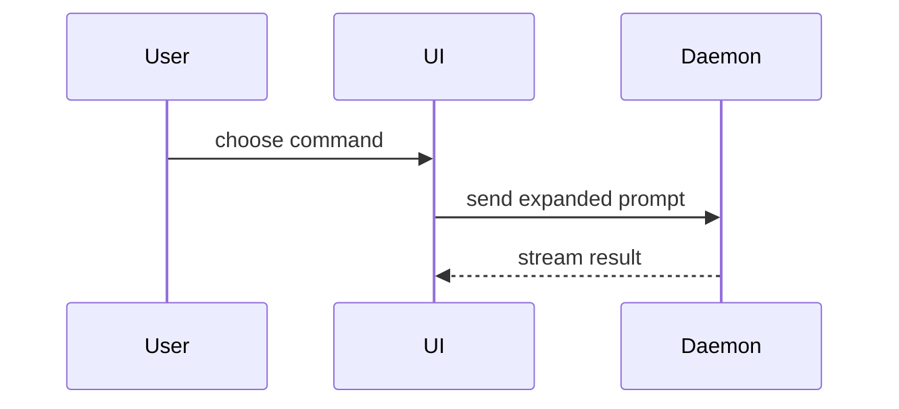

把当前话题画给用户看。不写开场白，正文从简。

这份文件是一份视图品种的清单：按话题挑一种，挑最省的那种。最后一种是 HTML 视觉件，它还要落盘并打开。

## 形状

- 逻辑或算法，写成伪代码：

```text
on(save)
  if content is unchanged
    return cached result
  write new content
  return fresh result
```

- 运行时的控制流，画成调用树：

```text
submitForm
  createSession
    persistPrompt
    launchAgent
  navigateToSession
```

- UI 结构，画成组件树，只留真正要紧的状态与模块边界：

```tsx
<SessionPage> (apps/example/src/routes/session.tsx)
  useSessionEvents()
  <SessionToolbar>
    <RunSkillButton> (packages/ui)
```

- 文件职责或一次大范围重构，画成浅树：

```text
src/
├── commands/       # parses user actions
├── sessions/       # owns session state
└── transport/      # sends API requests
```

- 组件之间怎么交互、控制流、数据流，用 Mermaid：



## 变了什么

要讲的是「变了什么」、而周围的形状本来就存在时，用 `diff`。缩进照搬上面那几种树，行首标 `+` / `-`，未改的行留原样。diff 的形状跟着改动的类型走——下面四种各自不同的地方在于「哪一行值得单独标出来」。

组件改动，标出新增的组件与它落进的父级：

```diff
 <SessionPage>
   useSessionEvents()
   <SessionToolbar>
+    <RunSkillButton />
   <SessionTimeline>
+    <SkillResultCard />
```

文件布局改动，一次说清新增、删除、改名与拆成目录：

```diff
 src/
 ├── commands/
+│   └── show-me.ts       # expands the slash command
 ├── sessions/
-└── transport.ts
+└── transport/
+    ├── client.ts
+    └── stream.ts
```

调用树或调用栈改动，标出新增的调用、以及被替换掉的整条路径：

```diff
 submitForm
   createSession
     persistPrompt
+    expandSkillMention
     launchAgent
-  navigateToSession
+  navigateToSession
+    subscribeToEvents
```

状态或控制流改动，旧行 `-`、新行 `+`，一个分支替换另一个分支：

```diff
 on(save)
-  write content
+  if content is unchanged
+    return cached result
+  write new content
+  invalidate cache
```

整块都新、或者省掉的上下文会藏住归属和顺序、或者用户需要一段能直接抄走的形状，就整块写出来：

```ts
function expandSkill(command: string): string {
  const skillName = command.slice(1)
  return `use the ${skillName} skill`
}
```

## HTML 视觉件

UI、布局、状态对比，或密到 Mermaid 画不清的概念，写一个专注的 HTML 文件：图、信息图、或几页幻灯片，哪个贴题用哪个。用真实的标签和数据，桌面上和窄屏上都读得通。

从本技能目录下的 `TEMPLATE.html` 起步：拷一份，样式块留着，正文换掉。数字条、卡片、目录树、前后对比、提示框都在里面。内容需要新形状时才往上加布局。

写到系统临时目录（`$TMPDIR`，没有就用 `/tmp`；Windows 上是 `%TEMP%`），文件名 `show-me-<描述>.html`，仓库里不落文件。然后打开给用户看，并给出绝对路径：

```
Bash(open path/to/show-me-{description}.html)
```

### 分寸

每个视觉件挨着它支撑的那几句话放。只留回答当前问题所需的那几个调用、文件、props、状态和边界。

下面这些手段用一种还是几种都行，全用上倒不太可能。自己判断，别一次性压垮用户。
